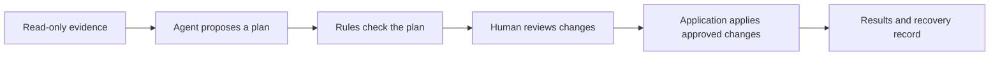

# Safepoint

Safepoint helps people review changes proposed by an AI agent before those changes reach real systems.

Instead of asking someone to approve a chat message, Safepoint's intended flow presents a clear change set: what the agent inspected, what it wants to change, what it left out, what looks risky, and what happened after approval. The current examples implement parts of this flow.

> **Status:** The app shell is implemented. [Brunch orders](docs/processes/brunch-orders/PLAN.md) is the active development hand-off: it is built end to end: instructions, a five-tab read, individually approved rules, calculation, order proposals, per-record review and a verified, undoable write to the sheet. Runs, rulebooks, proposals and decisions are kept on the server and the app can be deployed on Vercel behind a shared password. Learning from decisions, real sign-in and wider scope are planned.

## The idea



The agent can interpret incomplete or ambiguous information, but it cannot write to external systems. Ordinary application code checks non-negotiable rules and applies only approved, supported changes.

## The demonstration

The main demonstration in progress is one store's **Brunch orders** process for a promotion weekend.

- The sheet supplies five data tabs: Products, Stock, Sales, Deliveries and Parameters. Versioned instructions hold the purpose, promotion and plain-English rules.
- The development flow reads the sheet once, finds definitions in the instructions, checks each formula against worked examples and asks a person to accept or deny each definition.
- Planned phases calculate demand, propose order quantities, check them against accepted rules, let a person review them, and apply approved orders to the sheet with verification.

The earlier promotion-release prototype (a 27-line replay review) was removed; it can be recovered from the git tag `archive/promotion-prototype`.

The planned public demo uses synthetic data and accepts no arbitrary prompts or production credentials.

## Project principles

- The model proposes; deterministic code decides what is allowed to execute.
- Missing and excluded items are as visible as proposed changes.
- Approval never silently expands beyond what the reviewer saw.
- Successful writes are verified.
- Recovery is described honestly; it may require a compensating action or human intervention.
- Technical state is translated into plain operational consequences.

## Running locally

Requires [Node.js](https://nodejs.org) 24 LTS (see `.nvmrc`) and pnpm 10.34.5. The exact pnpm version is recorded in `packageManager`; use Corepack or another version manager that honours that field.

```bash
corepack enable
pnpm install --frozen-lockfile
pnpm dev
```

The application is then served at http://localhost:3000. The app runs without credentials. The development-only model pages need `GOOGLE_GENERATIVE_AI_API_KEY`, and reading the Google Sheet needs the Composio variables listed in `.env.example`; put real values in `.env.local`.

Checks:

```bash
pnpm build          # production build
pnpm lint           # ESLint
pnpm typecheck      # generate Next.js route types, then run strict TypeScript
pnpm format:check   # Prettier
pnpm test           # Vitest contract and fixture tests
pnpm check:tokens   # every var(--…) is defined, used and at most two reads from a colour
pnpm check:colours  # custom-ramp contracts and generated output
pnpm check:unused   # unused files, exports and dependencies (Knip)
pnpm check:colour-system # colour-system browser checks
pnpm trace:token <role>  # where a role is declared and what it paints (a tool, not a check)
```

CI (`.github/workflows/checks.yml`) runs `lint`, `typecheck`, `format:check`, `test`, `check:tokens`, `check:colours`, `check:unused` and `build`, then the Playwright suite (which includes the colour-system checks), on each push to `main` and each pull request. The visual baseline (`pnpm check:visual`) stays local: it records text metrics, which follow the fonts installed where it runs.

In development, the design pane's Neutrals control (or `?neutral=`) switches
between the five generated neutral families on the real application.

`pnpm dev` uses webpack rather than Turbopack, for development-only CSS source maps: Turbopack maps the combined Tailwind output to `app/styles/index.css`, losing the file each rule is written in.

- `app/styles/` holds the shared tokens and foundations; `app/styles/index.css` imports everything in cascade order.
- A component's own styles sit in a `.css` beside its `.tsx`, such as `components/app-shell/sidebar/process-list.css`. `components/app-shell/` is grouped by feature: `sidebar/`, `process/`, `runs/`, `thread/`, `assistant/`, `inputs/`, `instructions/`, `system/`, with the shell itself at the root.

Generated Tailwind utilities do not map to the JSX `className` that uses them. Use Option/Alt-click below to open the component in your editor; CSS source links open in DevTools. Rules expanded with `@apply` may lead to the utility definition.

Browser documentation: [Chrome source map settings](https://developer.chrome.com/docs/devtools/settings/preferences) and [Edge source maps](https://learn.microsoft.com/en-us/microsoft-edge/devtools/javascript/source-maps).

#### Open the CSS file in VS Code

Source maps alone open the original CSS inside DevTools. To send those clicks to VS Code, Microsoft Edge provides an **Open source files in Visual Studio Code** integration:

1. In Edge DevTools, open **Settings → Experiments**, enable **Open source files in Visual Studio Code**, and restart DevTools.
2. On localhost, choose **Set root folder**, select this repository's `safepoint` directory, and allow access. You can also add the folder under **Settings → Workspace**.
3. Under **Settings → Workspace**, ensure **Open source files in Visual Studio Code** is enabled.
4. Inspect an element and click its CSS filename in **Styles**. A linked file opens in VS Code at the selector's line.

This is an Edge-specific integration; the source-map setting in Chrome does not itself launch VS Code. See [Microsoft's setup instructions](https://learn.microsoft.com/en-us/microsoft-edge/devtools/sources/opening-sources-in-vscode).

The CSS debugging configuration emits `file:///` URLs for existing source files so DevTools can match them directly to the local Workspace. After changing this configuration, close and reopen DevTools and reload the page. If a style still points to a `webpack:///` URL, the browser is using the earlier map. Generated sources without a file on disk retain their virtual URLs.

### Click-to-source in the browser

Hold <kbd>Option</kbd>/<kbd>Alt</kbd> under `pnpm dev` and point at any element: the style inspector names the component whose JSX wrote it, with a link to that line in your editor, and each component it sits in. It reads React's own development data, so there is no build step and no browser extension. See [`docs/interface/STYLING-SYSTEM.md`](docs/interface/STYLING-SYSTEM.md) → Finding where a style is written.

### Switching typefaces in the browser

The families are still provisional, so components address the three semantic roles from [the styling system](docs/interface/STYLING-SYSTEM.md#type-scale) — display, interface sans, and tabular utility — and never a family name. A `data-typeface` attribute decides which family fills each role, alongside the existing `data-theme`. Three of the available sets ([`lib/ui/typography.ts`](lib/ui/typography.ts) lists them all):

| Set               | Display     | Interface | Utility                |
| ----------------- | ----------- | --------- | ---------------------- |
| `geist` (default) | Geist       | Geist     | Geist Mono             |
| `glide`           | Glide       | Glide     | Glide Mono             |
| `inter`           | Inter Tight | Inter     | Inter, tabular figures |

The utility role is a second axis, because which mono suits a given sans is the open question and every pairing has to be reachable. `data-mono` overrides just that role — for example `sans` (the interface family with `tnum`), `geist`, `glide`, `jetbrains` or `commit`; `MONO_CHOICES` lists them all — and no attribute leaves the set's own choice in place.

The Inter set deliberately has no separate mono. The spec asks for a "tabular **or** monospaced" utility role, and what the role carries here is mostly short English labels in tracked uppercase, where fixed advance widths only make word colour uneven, plus figures that need `tnum` rather than monospacing. `data-mono` puts a real mono back for comparison.

The **Aa** control in the bottom-right corner of the running app switches the set, the utility family, and the theme, and remembers the choice. `?font=glide&mono=commit` pins a combination for a screenshot or a shared link. Next's own dev indicator has no extension point for this, so the control is separate and sits opposite it.

Only the default set is preloaded; the alternates emit `@font-face` rules but download nothing until a role selects them. To change the shipped default, edit `DEFAULT_TYPEFACE_SET` in [`lib/ui/typography.ts`](lib/ui/typography.ts) and the `:root` role block in [`app/styles/type.css`](app/styles/type.css). Stylistic sets and mono weights belong in those same blocks, and the sans and the mono carry separate feature tokens: `ss01` names a different alternate in every family, so a setting that is right for the interface family is wrong for a mono paired across from it. Weights are per-family too — Glide Mono has only one, so it pins both weight tokens to 400.

Vendored under [SIL OFL 1.1](app/fonts/): [Glide](https://blode.co/glide) and [Commit Mono](https://commitmono.com/) (the [Fontsource](https://www.npmjs.com/package/@fontsource/commit-mono) build, which instances the variable source into real 400/500/600 cuts — the upstream release ships only 400 and 700). Inter, Inter Tight, and JetBrains Mono come from Google Fonts through `next/font`.

## Access outside local development

Local development has no gate. Anywhere else, every page and `/api/trpc` sits behind one shared password, and a deployment sets two variables (names in `.env.example`; values in the host's own settings, never in the repository):

- `SAFEPOINT_ACCESS_KEY`, the shared password, at least 16 characters.
- `SAFEPOINT_COOKIE_SECRET`, the key the cookie is signed with, at least 32 characters.

With either missing or too short, every request is refused with "This deployment is not configured." rather than let anyone in. Generate each with `openssl rand -base64 32`.

A person enters the password and their name once; both are held in a signed cookie for 30 days, and the name is the actor written on each decision. What this is not:

- **One password for everyone.** There are no accounts or roles.
- **A self-declared name.** The name is whatever the person typed; nothing verifies it.
- **Unthrottled.** Nothing limits attempts, so the password must be long and random.

To sign everyone out, or to rotate, change `SAFEPOINT_COOKIE_SECRET` (and `SAFEPOINT_ACCESS_KEY`, to change the password). The development-only tools (`/workbench`, `/api/dev`) refuse outside local development whoever is signed in. To try the gate on your own machine, start the server with `SAFEPOINT_GATE=1` and both variables set.

## Deploying to Vercel

A checklist, in order. Both Brunch orders processes are served wherever the gate applies; the development tools (`/workbench`, `/api/dev`) are not, whoever is signed in. Nothing here is done by the repository: each step is a setting in Vercel or Neon.

**1. Project settings** (Settings in the Vercel project)

- Framework preset Next.js, Node.js version 24.x (`engines`), install command the default (`pnpm install --frozen-lockfile`). Fluid compute on (the default for new projects).
- **Build command:** leave it empty. Vercel runs the `vercel-build` script in place of `build` (`scripts/vercel-build.ts`). To be explicit, set the build command to `pnpm vercel-build`.
- **Enable access to System Environment Variables** (Environment Variables), then redeploy. Workflow knows it is deployed by `VERCEL_DEPLOYMENT_ID`, which Vercel exposes only with this setting; without it the build emits local output, every run fails on the read-only filesystem (`EROFS`), and no run appears in the dashboard. The build also reads `VERCEL_ENV` to decide whether to migrate.
- Nothing to set for Workflow's queue: the request proxy (`proxy.ts`) leaves `/.well-known/workflow/` open, as Workflow authenticates each delivery itself.
- Deploy from a clean checkout with `vercel deploy --prod --archive=tgz`, which uploads one archive. The per-file upload hit the Hobby plan's daily file limit. The CLI does not apply `.gitignore`'s folder rules (it sent agent worktrees, kept run data and reports), so `.vercelignore` names what must not be uploaded and must be kept in step with `.gitignore` when a new local folder appears.
- The project is connected to the GitHub repository: a push to `main` deploys to production (its build migrates first), and a push to any other branch makes a preview, which has no database or gate variables of its own and so answers that it is not configured. A deploy by hand, as above, is for when Git is not the source.
- Function duration: `app/api/trpc/[trpc]/route.ts` asks for 300 seconds, the most a Hobby plan allows, for the cross-check and the rule advice, which ask a model inside the request and can need longer. On Pro, raise `maxDuration` there towards 800.

**2. Environment variables** (names only; values in the project's settings, never in the repository)

| Name                                                                                                       | What it is                                                                                                                    | Production                  | Preview                                         |
| ---------------------------------------------------------------------------------------------------------- | ----------------------------------------------------------------------------------------------------------------------------- | --------------------------- | ----------------------------------------------- |
| `SAFEPOINT_ACCESS_KEY`                                                                                     | The shared password, at least 16 characters.                                                                                  | yes                         | yes                                             |
| `SAFEPOINT_COOKIE_SECRET`                                                                                  | The key the cookie is signed with, at least 32 characters.                                                                    | yes                         | yes                                             |
| `DATABASE_URL`                                                                                             | Neon's pooled URL (host ending `-pooler`). Unset on Vercel, a request that needs the database fails with a message naming it. | yes                         | a Neon preview branch's, if branching is set up |
| `DATABASE_URL_UNPOOLED`                                                                                    | Neon's direct URL, which migrations use. A production build without it stops.                                                 | yes                         | only with the above                             |
| `GOOGLE_GENERATIVE_AI_API_KEY`                                                                             | The model key, for drafting, rewriting, proposing, cross-checks and advice.                                                   | yes                         | if previews should draft                        |
| `COMPOSIO_API_KEY`, `COMPOSIO_USER_ID`, `COMPOSIO_GOOGLESHEETS_ACCOUNT_ID`, `GOOGLE_SHEETS_SPREADSHEET_ID` | The live Google Sheet, read and written through Composio. Without them the captured read still works.                         | if the live sheet is wanted | if previews should reach it (they write to it)  |
| `GEMINI_REQUESTS_PER_MINUTE`                                                                               | Optional. Requests a minute per model group.                                                                                  | optional                    | optional                                        |

Never set in production (or preview): `SAFEPOINT_RESETTABLE_DATABASE_URL`, which marks a database as one `pnpm db:reset` may drop; `SAFEPOINT_GATE`, which only turns the gate on in local development; `SAFEPOINT_PGLITE_DIR` and `SAFEPOINT_DATA_DIR`, which belong to local files; and `WORKFLOW_TARGET_WORLD` and `WORKFLOW_LOCAL_DATA_DIR`. Workflow picks the Vercel World itself; `local` fails on the first write, and `vercel` does not make up for the system-variables setting above. A preview that shares the production database writes to it: give previews a Neon branch of their own, or leave them without `DATABASE_URL` so they refuse.

**3. The build**

`vercel-build` migrates, then builds, and only for `VERCEL_ENV=production`: it applies `drizzle/` over `DATABASE_URL_UNPOOLED` (never the pooled URL) and stops the build if that fails or if either URL is missing. A preview or development build, and a local `pnpm build`, do not touch a database: a preview may share the production database unless Neon preview branching is set up, and would otherwise migrate production before anyone had promoted it. `next.config.ts` lists the files the server reads at run time (`fixtures/brunch-orders/`), so Vercel bundles them with the routes that need them.

**4. The first deploy**

1. The build applies every migration not yet applied to the production database.
2. The first request that needs a process's rulebooks seeds them from `fixtures/` (once per server process, inserting only what is missing; `server/storage/rules/rulebook-files.ts`).
3. Drafts, rewrites and proposals run as Workflow runs on the Vercel World; the dashboard's Workflow page lists them.

**5. Check that it worked**

- The build log says "Migrating the production database before the build." and then "Migrations applied to the server at <host>."; a preview's says "Not migrating".
- The deployment's address sends you to `/access`; the password and a name sign you in. Without the two secrets, every page says "This deployment is not configured."
- The sidebar lists Brunch orders twice (the rulebook process and the direct one); `/processes/brunch-orders` opens, a run reads the captured sheet, and the Rules panel shows the nine accepted rules.
- `/workbench` and `/api/dev/stylesheets` answer not found, signed in or not; an unsigned `/api/trpc/runs.list` answers 401.
- Proposing needs the model key; after it, a run appears in the dashboard's Workflow page.

A step runs within one function invocation, whose limit is the plan's maximum (the generated route asks for `maxDuration: 'max'`, at most 800 seconds): writing one rule, which may take several model calls, must finish inside it. In development nothing needs setting: `pnpm dev` uses the Local World in `.next/workflow-data/`, and `npx workflow web` shows its runs when started with `WORKFLOW_LOCAL_DATA_DIR=.next/workflow-data`.

To try production mode on your own machine, run `pnpm build`, then `next start` with `NODE_ENV=production`, both gate variables, `DATABASE_URL=` empty and `SAFEPOINT_PGLITE_DIR` pointing at a scratch folder outside the repository. Chromium accepts the `Secure` cookie from `http://localhost`; another browser or host needs https.

## Documentation

The [documentation index](docs/README.md) separates current guidance, process plans, research and historical records. Start with:

- [Product brief](docs/product/PRODUCT-BRIEF.md)
- [Brunch orders plan](docs/processes/brunch-orders/PLAN.md): the active hand-off
- [Architecture](docs/engineering/ARCHITECTURE.md)
- [Definitions engine](docs/engineering/DEFINITIONS-ENGINE.md)
- [Experience principles](docs/product/EXPERIENCE-PRINCIPLES.md)
- [Styling system](docs/interface/STYLING-SYSTEM.md)

## Next step

Continue the [Brunch orders plan](docs/processes/brunch-orders/PLAN.md) from its next gated phase; what is still open (sign-in, throttling, retention) is in [`TODO.md`](TODO.md).

The [archived delivery plan](docs/archive/DELIVERY-PLAN.md) records broader persistence, execution and release goals; it does not describe implemented behaviour. The working checklist is in [`TODO.md`](TODO.md).
