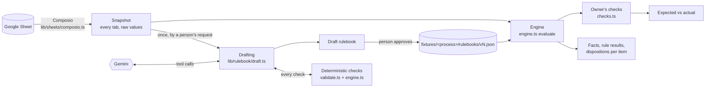
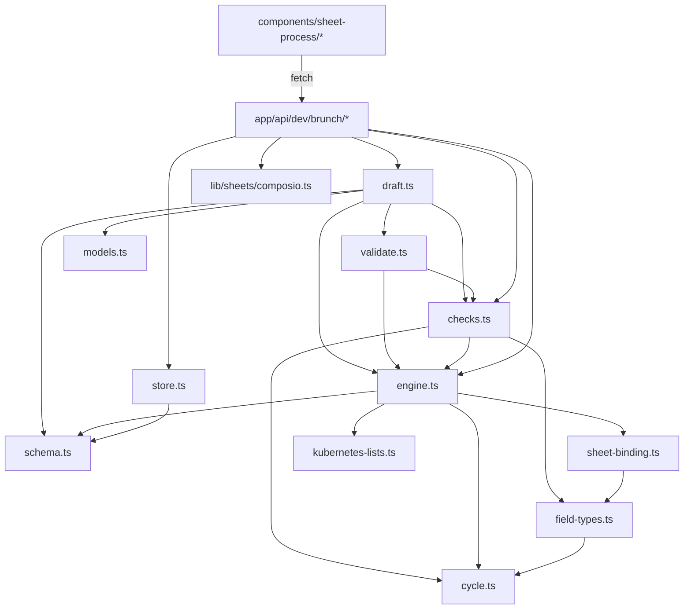
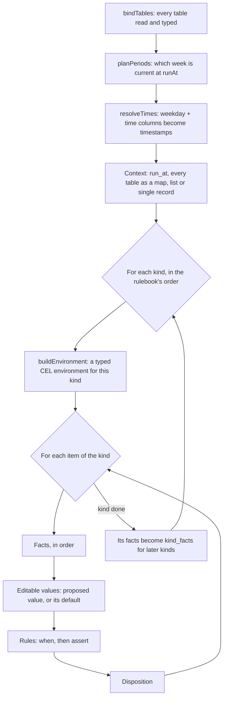
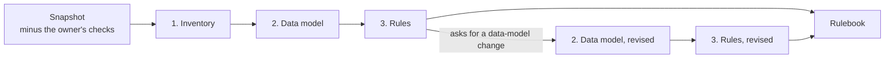
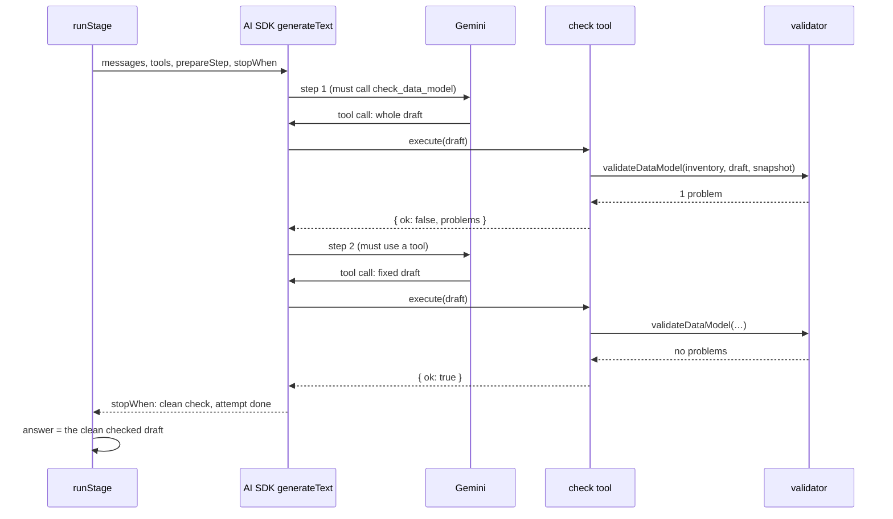
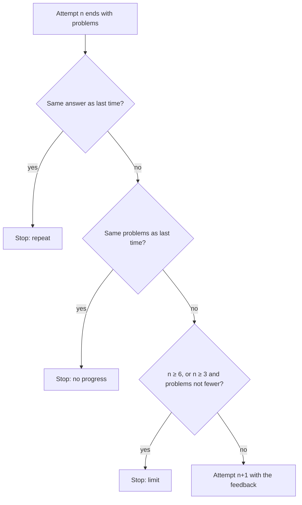
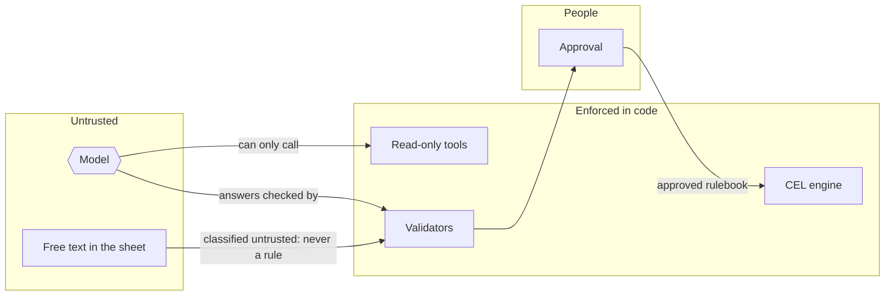

# Rulebook engine: a guide to the code

> **Work in progress.** This describes the code as of 7 October 2026. The
> engine is still being built ([`SHEET-PROCESS-PLAN.md`](SHEET-PROCESS-PLAN.md));
> update this guide in the same change as the code it describes. Function and
> constant names are given so you can search for them; line numbers are not,
> because they move.

This guide is for an engineer opening `lib/rulebook/` for the first time. It
explains what the engine does, which file does what, how a spreadsheet cell
becomes a value a rule can test, and in most detail how `draft.ts` gets a
language model to write a rulebook that the deterministic engine accepts.

What went wrong along the way, and what each fix bought, is in
[`RULEBOOK-DEVELOPMENT-LOG.md`](RULEBOOK-DEVELOPMENT-LOG.md). The general ideas
behind it are in [`LLM-RULES-GUIDE.md`](LLM-RULES-GUIDE.md).

## Contents

1. [The idea in one paragraph](#1-the-idea-in-one-paragraph)
2. [Words you will meet](#2-words-you-will-meet)
3. [The big picture](#3-the-big-picture)
4. [Where everything lives](#4-where-everything-lives)
5. [From a cell to a value a rule can test](#5-from-a-cell-to-a-value-a-rule-can-test)
6. [How the engine evaluates](#6-how-the-engine-evaluates)
7. [How a rulebook is drafted (`draft.ts`)](#7-how-a-rulebook-is-drafted-draftts)
8. [The checks that keep the model honest (`validate.ts`)](#8-the-checks-that-keep-the-model-honest-validatets)
9. [The owner's checks (`checks.ts`)](#9-the-owners-checks-checksts)
10. [Routes, the page and saved files](#10-routes-the-page-and-saved-files)
11. [Tests](#11-tests)
12. [Common tasks](#12-common-tasks)
13. [Known limits](#13-known-limits)
14. [Writing CEL for this engine](#14-writing-cel-for-this-engine)
15. [Security and trust boundaries](#15-security-and-trust-boundaries)
16. [AI SDK concepts used here](#16-ai-sdk-concepts-used-here)

Hands-on companions are in
[`RULEBOOK-ENGINE-WALKTHROUGHS.md`](RULEBOOK-ENGINE-WALKTHROUGHS.md): reading a
real draft record, the anatomy of a complete rulebook, and running a drafting
study.

## 1. The idea in one paragraph

A spreadsheet holds data (products, stock, sales) and policy (rules written in
plain words, limits, timetables). A language model reads the sheet **once** and
drafts a **rulebook**: how to read each tab, what to calculate, and every rule
as a formula in CEL (Common Expression Language). Code checks every part of
the draft, a person approves it, and from then on the **engine** runs the
rulebook with no model involved: same sheet, same run time, same answer. The
model writes the rules; it never _is_ the rules.

## 2. Words you will meet

| Word                | Meaning                                                                                                                                                                                                                                                                                                                                            |
| ------------------- | -------------------------------------------------------------------------------------------------------------------------------------------------------------------------------------------------------------------------------------------------------------------------------------------------------------------------------------------------- |
| **Snapshot**        | One read of the whole sheet: every tab as a list of rows of raw cell values. `Snapshot` in `engine.ts`.                                                                                                                                                                                                                                            |
| **Rulebook**        | Everything specific to one process, as data: inventory + data model + logic. `rulebookSchema` in `schema.ts`.                                                                                                                                                                                                                                      |
| **Inventory**       | What the policy says, before anything is built: tab roles, policy statements, kinds of item, values a proposal may change.                                                                                                                                                                                                                         |
| **Data model**      | How to read the sheet: tables and their typed columns, the currency, the weekly timing, the kinds of item.                                                                                                                                                                                                                                         |
| **Logic**           | Editable values, facts and rules, all as CEL formulas.                                                                                                                                                                                                                                                                                             |
| **Item** / **kind** | One thing a person reviews (a product, the kit). A kind is a type of item, read from one table.                                                                                                                                                                                                                                                    |
| **Fact**            | A named calculated value per item, such as `available = on_hand - reserved`. Rules read facts.                                                                                                                                                                                                                                                     |
| **Editable value**  | A value a proposal may change (an order quantity, a price). Which values may change is the agent's write authority, set by the process owner in the process definition (`BRUNCH_MAY_CHANGE` in `lib/processes/avocado-toast/process.ts`), never read from the sheet; drafting maps each onto the sheet's data. Formulas see it as `change.<name>`. |
| **Rule**            | `when` (optional) and `assert`, both CEL that must be `true`/`false`, with an outcome: `block` or `attention`.                                                                                                                                                                                                                                     |
| **Disposition**     | An item's result: `blocked`, `needs_decision` or `ready`.                                                                                                                                                                                                                                                                                          |
| **Assumption**      | A choice a rule or fact makes that its statement's text does not (`assumes`: the assumption and one to three alternative readings, in the owner's everyday words, plus `technical`, the field, number or formula part concerned). The reviewer confirms it, picks an alternative, or says none fits.                                               |
| **Owner decision**  | The owner's answer to an assumption, kept in the app (`fixtures/<process>/decisions.json`), never written to the sheet, given to every draft as policy, and stale once the statement's text changes.                                                                                                                                               |
| **Owner's checks**  | Expected outcomes written by the sheet's owner in a tab the model never sees. They score a rulebook; they are not part of it.                                                                                                                                                                                                                      |
| **Stage**           | One part of drafting: inventory, data model, rules.                                                                                                                                                                                                                                                                                                |
| **Attempt**         | One try at a stage. A failed attempt's problems go back to the model for the next one.                                                                                                                                                                                                                                                             |
| **Step**            | One request to the model inside an attempt. A step usually ends with a tool call; the tool's result starts the next step.                                                                                                                                                                                                                          |
| **Check tool**      | A function the model calls to test its draft against the sheet, using the same code that judges the final answer.                                                                                                                                                                                                                                  |

## 3. The big picture



Two loops run at very different speeds:

- **Drafting** is rare, slow (one to five minutes) and uses a model. It produces
  a rulebook.
- **Evaluation** is constant, fast (milliseconds) and uses no model. It runs
  the approved rulebook on a snapshot at a chosen run time.

Everything the model writes passes through the same deterministic checks
before a person sees it, and the owner's checks score it without the model ever
seeing them.

## 4. Where everything lives

### The engine: `lib/rulebook/`

| File                  | What it does                                                                                                                       | Read it when                                     |
| --------------------- | ---------------------------------------------------------------------------------------------------------------------------------- | ------------------------------------------------ |
| `schema.ts`           | Zod schemas of the rulebook: `inventorySchema`, `dataModelSchema`, `logicSchema`. Their `.describe()` texts are sent to the model. | First. Everything else is built on these shapes. |
| `field-types.ts`      | `interpretCell`: one raw cell to a typed value, with a sentence saying how.                                                        | A value looks wrong.                             |
| `sheet-binding.ts`    | `bindTab`: finds columns by header (never by position) and interprets every cell, keeping its A1 reference.                        | A column is "missing".                           |
| `cycle.ts`            | Calendar maths: weekdays, `zonedInstant` (wall clock to instant across clock changes), week arithmetic.                            | Times are off by an hour.                        |
| `engine.ts`           | `bindTables`, timing, the CEL environment (`buildEnvironment`, `checkFormula`) and `evaluate`.                                     | You need to know what a formula can see.         |
| `kubernetes-lists.ts` | `sum()` from the Kubernetes CEL list library, registered on every environment.                                                     | A total over a list.                             |
| `validate.ts`         | `validateInventory`, `validateDataModel`, `validateLogic`: every check on a draft, each problem with how to fix it.                | A draft is rejected, or you add a check.         |
| `draft.ts`            | The drafting pipeline: prompts, stages, tool calls, retries, model fallback.                                                       | Section 7.                                       |
| `models.ts`           | The Gemini models drafting may use, newest first, and the fallback chain.                                                          | A model is retired or added.                     |
| `checks.ts`           | `checksTab`, `runChecks`: the owner's checks.                                                                                      | Scores look wrong.                               |
| `store.ts`            | Approved rulebooks (`fixtures/<id>/rulebooks/vN.json`) and draft records (`.rulebook-drafts/`).                                    | Saving or listing.                               |
| `run-time.ts`         | Turns the page's "now / weekday / exact" choice into a run instant.                                                                | The Calculate step.                              |
| `library.fixture.ts`  | A deliberately unrelated rulebook (library loans) used by tests.                                                                   | Writing a test.                                  |

### Around it

| Place                                         | What it does                                                                             |
| --------------------------------------------- | ---------------------------------------------------------------------------------------- |
| `lib/sheets/composio.ts`                      | Reads every tab of the Google Sheet through Composio, at its real size.                  |
| `lib/processes/avocado-toast/`                | This one process: its id, its page steps, loading the captured or live snapshot.         |
| `app/api/dev/brunch/*/route.ts`               | Development-only routes: `sheet`, `capture`, `draft`, `drafts`, `approve`, `evaluate`.   |
| `components/sheet-process/`                   | The page's steps: read the sheet, rules (draft, past drafts, approve), calculate, check. |
| `app/(shell)/examples/avocado-toast/page.tsx` | The page that puts the steps in the process thread.                                      |

### What imports what

Arrows point from a module to what it uses. Nothing in `lib/rulebook/` imports
React, Next.js or anything about avocados.



## 5. From a cell to a value a rule can test

Follow one cell, the regular price of a ripe avocado pack, `Products!E3`:

```text
Google Sheets            2.2                       (UNFORMATTED_VALUE: a number, in pounds)
  │ composio.ts          valueRanges[…].values[2][4] = 2.2
  ▼
bindTab                  header "regular_price" found in row 1, column E
  │ sheet-binding.ts     → interpretCell(2.2, { kind: 'money', currency: GBP/2 })
  ▼
interpretCell            value 220, display "£2.20",
  │ field-types.ts       how "2.2 GBP × 100 = 220 minor units (stored as a whole number)."
  ▼
bindTables               toCel: money is CEL int → 220n (a BigInt)
  │ engine.ts            stored on the row object as regular_price, with ref "Products!E3"
  ▼
CEL                      products['AV-RR'].regular_price == 220
```

Why each step exists:

- **By header, never by position.** If someone inserts a column, the binding
  still finds `regular_price`; if someone renames it, it is reported missing
  rather than silently read from the wrong place.
- **Money as whole minor units.** In floating point `50 × 1.1` is
  `55.00000000000001`, so rounding up gives 56. Integers make limits exact.
- **Every value keeps its cell reference** so the page can link any number back
  to the sheet, and every conversion says in words what it did.

The column types and what formulas see:

| Column type    | Sheet holds                            | Formulas see                                  |
| -------------- | -------------------------------------- | --------------------------------------------- |
| `key`, `text`  | text                                   | `string`                                      |
| `whole_number` | a whole number                         | `int`                                         |
| `decimal`      | any number                             | `double`                                      |
| `percent`      | a percentage cell (0.25) or text "25%" | `double` fraction, 0.25                       |
| `money`        | an amount in the rulebook's currency   | `int` minor units (pence, cents)              |
| `date`         | a date cell or "2026-10-15"            | timestamp, midnight in the rulebook time zone |
| `datetime`     | a date-time cell or "2026-10-15 08:45" | timestamp                                     |
| `weekday`      | Mon … Sun                              | `string`; turned into times by the timing     |
| `time_of_day`  | a fraction of a day (0.3125)           | `int` minutes after midnight (450)            |
| `yes_no`       | yes / no                               | `bool`                                        |
| `one_of`       | one of a fixed list                    | `string`                                      |

A blank optional cell is **absent**, not null. Formulas read it as
`row.?field.orValue(0)` or test it with `row.?field.hasValue()`.

## 6. How the engine evaluates

`evaluate(rulebook, snapshot, runAt, options)` in `engine.ts` does this:



**What a formula can see** for an item of kind `product` (built by
`buildEnvironment`; `describeEnvironment` lists the same for the model):

| Variable                      | What it is                                                                                                                                                                                   |
| ----------------------------- | -------------------------------------------------------------------------------------------------------------------------------------------------------------------------------------------- |
| `run_at`                      | The run time, a timestamp.                                                                                                                                                                   |
| `key`                         | This item's key, such as `"AV-RR"`.                                                                                                                                                          |
| `row` (or `rows` for a group) | This item's row(s) of its own table.                                                                                                                                                         |
| `products`, `stock`, `kit`, … | Every table: keyed tables as `map<string, row>`, lists as `list<row>`, single (key/value) tables as one record.                                                                              |
| `facts`                       | This item's facts calculated so far.                                                                                                                                                         |
| `change`                      | This item's editable values (proposed or default). Facts may not read it.                                                                                                                    |
| `product_facts`, …            | Facts of the kinds listed **before** this one in `items`, as `map<string, facts>`. This is how the kit reads its components. A later kind's facts do not exist yet, so they are not offered. |

Every variable and field is **typed**: `row.on_hnad` or comparing money with a
date fails when the formula is checked, before it ever meets data.

**Rule status:** `when` false gives `not_applicable`; `assert` true gives
`pass`, false gives `fail`; an exception (missing value, overflow) gives
`error`.

**Disposition:** any `error`, or any failed `block` rule, makes the item
`blocked`; otherwise any failed `attention` rule makes it `needs_decision`;
otherwise it is `ready`. An error blocks: when the engine cannot tell, it says
no.

**Timing** (when the sheet has a weekly timetable): an _observation_ (a stock
count) resolves to its latest occurrence at or before the run; a _deadline_
(an order cut-off) resolves inside the week being planned. The current week
lasts until the deadline named by `timing.current_until` passes.

**Showing the working:** with `evaluate(…, { explain: true })`, each rule result also carries its conditions for that item (`lib/rulebook/working.ts`). The formula is split from its parsed tree wherever it joins conditions with `&&` and `||`, and each condition is evaluated on its own. It records:

- whether it held, did not, could not be evaluated, or was never reached (CEL stopped earlier);
- whether it settled the rule's result, meaning it was the last one evaluated;
- a comparison's two computed sides (`157 ≤ 24`);
- the condition with its values written in;
- each value it read, with its meaning and the cell it came from (`Parameters!D3`), or "calculated", "proposed" or "starting value".

A value inside a list expression (`kit.map(…).sum()`) is shown as that expression's one value, and a whole table is never listed as a value. Money shows in its currency, a percentage with %, a time in the rulebook's time zone. The Check step shows each condition in a row, coloured in the review's tone only where it settled the result. Hovering or focusing a condition shows its values, and "Show working" lists every condition filled in, with a table of the values. The dry run and the owner's checks do not ask for this.

**Testing a draft before approving it:** Calculate runs the approved rulebook, or the draft open in the Rules step, which it offers by default when one with a rulebook is open. The draft is loaded on the server from its saved record by file name, so what runs is exactly what was saved. Every result from a draft is labelled "Testing the draft of …, not approved", and the per-item working, what-if values, owner checks and drift check all work as for the approved one. Nothing becomes the rulebook in force until a person approves it.

**An approved rulebook is checked again:** the sheet can change under it, and checks are added after it was approved. `validateRulebook` runs every check a draft must pass (inventory, data model, logic, open requests); approval runs it on the draft, and the page runs it on the active rulebook on every load and every Calculate. Anything it fails is shown above the Approved rulebook and the Check step's results, as a warning that those results may be wrong until a new version is approved. A saved draft is checked the same way when it is opened (`validateSaved`, which first reads it as today's schema and reports one saved in an older shape), so a draft that passed when it was made but would now be refused says so before anyone presses Approve.

**What-if values:** before any proposal, every editable value is at its starting value (an order of 0), so a rule guarded by "nothing ordered" passes without testing anything. In the Check step, each item has a form for its editable values. Typing one reruns the same evaluation with it as a proposed value (`overrides`), and a banner lists what is in effect until "Clear all" or Calculate. A typed value is read as the sheet reads a cell of its type (`readWhatIf`): "£4.75" is 475 minor units, "25" for a percentage is a quarter. A value that cannot be read is left out and reported beside its field, and the last result stays on screen. Nothing is written to the sheet.

**Limits:** a formula may have at most 500 AST nodes (`MAX_AST_NODES`). CEL
itself cannot loop forever, touch the network or write anything.

## 7. How a rulebook is drafted (`draft.ts`)

This is the most involved file. The rest of this section builds it up piece by
piece.

### 7.1 Three stages, and at most one revision



| Stage      | The model is asked for                                                               | Checked by          | Check tool                                         |
| ---------- | ------------------------------------------------------------------------------------ | ------------------- | -------------------------------------------------- |
| Inventory  | Tab roles, every policy statement with its cells and needs, kinds, changeable values | `validateInventory` | `check_inventory`                                  |
| Data model | Tables, column types, currency, timing, items, covering the inventory                | `validateDataModel` | `check_data_model`                                 |
| Rules      | Editable values, facts, rules, `not_ruled`, `data_model_requests`                    | `validateLogic`     | `check_rules`, plus `check_formula`, `try_formula` |

`draftRulebook` runs them in order. If the rules stage returns
`data_model_requests` ("the kit needs to be a kind of item"), the data model
stage runs once more with those requests, then the rules stage again. Round 2
never repeats, so drafting cannot loop.

Splitting the work matters. With only the data model and rules stages, a
light model never made the kit a kind of item and quietly dropped its rules;
asked first only "what does the policy say?", it found the kit (see the log).

### 7.2 What a tool is

A **tool** is a function the model may ask the app to run. It is declared with
the AI SDK's `tool()`:

```ts
tool({
  description: 'Check a complete draft of your answer against the sheet: …',
  inputSchema: dataModelSchema, // what the model must send
  execute: async (draft) => {
    // what our code does with it
    const problems = validateDataModel(inventory, draft, snapshot);
    return problems.length ? { ok: false, problems } : { ok: true };
  },
});
```

When `generateText` is called with `tools`, the SDK sends each tool's name,
description and input schema to the model. The model can then reply with a
**tool call** instead of text: `check_data_model` with a JSON argument. The SDK:

1. validates the argument against `inputSchema` (if it does not fit, the model
   receives the validation error as the tool's result);
2. runs `execute` with it;
3. adds the call and its result to the conversation;
4. calls the model again: the next **step**.

`checkTool()` builds the three whole-answer check tools from a schema and a
validator. Each call also records the draft and its problems in
`spec.checked.last`, and an entry in the tool log the page shows. The rules
stage adds two small tools: `check_formula` type-checks one formula, and
`try_formula` evaluates one formula on one real item through
`evaluate(…, { probe })`.

All tools are **read-only**. None can write to the sheet, see the owner's
checks or reach the network.

### 7.3 Inside one attempt: check, fix, check again

`runStage` makes one `generateText` call per attempt and steers it with two
hooks:

- **`prepareStep`** runs before every step and chooses what the model must do
  next.
- **`stopWhen`** runs after every step and decides whether the attempt is over.

| Before step…                | `prepareStep` chooses                               | Why                                                        |
| --------------------------- | --------------------------------------------------- | ---------------------------------------------------------- |
| the first                   | `toolChoice: { type: 'tool', toolName: 'check_…' }` | The model must check its whole draft before anything else. |
| after a check with problems | `toolChoice: 'required'`                            | It must keep using tools: fix, then check again.           |
| the last allowed            | `toolChoice: 'none'`                                | It must answer in text now.                                |

| `stopWhen` ends the attempt when…                    | Then                                               |
| ---------------------------------------------------- | -------------------------------------------------- |
| a check comes back clean                             | That checked draft **is** the answer.              |
| three checks in a row find exactly the same problems | The attempt ends early: more of the same is waste. |
| the step limit is reached (10, or 40 for rules)      | The attempt ends with what it has.                 |



**Why the check tool is how an answer is submitted.** Gemini refuses a forced
tool call when a JSON response format is also requested (HTTP 400). So no JSON
format is requested at all: the answer is the draft that passed the check,
whose shape the tool's input schema already enforced. If a model answers in
text instead, `parseAnswer` reads and checks that text too.

After the call, `runStage` decides what the attempt produced, in this order:

1. a clean checked draft: the answer;
2. otherwise text that parses and fits the schema: checked as an answer;
3. otherwise the last checked draft and its problems;
4. otherwise "no answer".

**Keeping requests small.** Every step resends the conversation, and every
check carries a whole draft. `latestCheckOnly` (called in `prepareStep`) sends
only the original request and the latest check onwards, because earlier drafts
have been superseded. That cut the inventory stage from 117,111 to 48,454 input
tokens for about the same number of checks.

### 7.4 Between attempts: the conversation and when to stop

If an attempt ends without a clean draft, `runStage` replaces the previous
answer in the conversation with the latest one and adds `feedback(issues)`: a
list of problems, each with what to change. The model sees its own answer as
its own turn, then the problems, so it fixes rather than starts again.



Three attempts are given outright, more up to six only while the number of
problems keeps falling. A stopped stage is recorded as `draft.stopped`, which
the page shows ("Data model gave up after 2 attempts with 1 problem left: the
model sent back the same answer"), and a stuck Flash-Lite draft can be
continued with the newest Flash model from the stage that stopped
(`carryOver`, the `resume` option).

### 7.5 When the model service fails

A failure of the service is not the model's mistake and never costs an
attempt. `serviceFailure` classifies it:

| What happened                                          | What the drafter does                                                                                         |
| ------------------------------------------------------ | ------------------------------------------------------------------------------------------------------------- |
| 429 with a retry delay up to 90 s (a per-minute limit) | Waits as Google asks, then carries on on the same model from the last checked draft. At most 3 waits a stage. |
| 429 without one, or longer (a daily limit)             | Moves to the next older model in the same family.                                                             |
| 503 busy, 404 model gone, timeout                      | Moves to the next model.                                                                                      |
| 400 invalid request                                    | Stops: the same request would fail on every model.                                                            |
| No model left                                          | Stops the draft; `draft.interrupted` says why.                                                                |

The limit is named from Google's response (`quotaOf`): "Google's generate
content input tokens per model per minute (free tier), limit 250,000 was
reached". The SDK also retries briefly by itself (`maxRetries`, once when an
older model can take over, three times on the last).

The model chain comes from `fallbackChain` in `models.ts`: Gemini 3.8 → 3.7 →
3.6 → 3.5 Flash, or 3.5 → 3.1 Flash-Lite. A draft never falls from Flash to
Flash-Lite on its own; that would quietly lower the quality.

### 7.6 Worked examples from real drafts

Each of these happened in real drafts of the Brunch weekend sheet. The messages
are shown as the code writes them today; the values are illustrative.

**A shape mistake, caught by the SDK.** The model's data model said
`items[0].table: "Products"` (the tab) instead of `"products"` (the table's
name). The tool's input schema rejects it before `execute` runs, and the model
receives the validation error as the tool result. The tool log records it as
"input did not fit the schema". Before this was handled, the same mistake
spent three whole attempts with the reply "your answer could not be read".

**A meaning mistake, caught by the validator.** The model pointed
`timing.current_until` at a sheet field instead of a declared time. The check
returns:

> `{ table: "promotion", time: "ends_time" }` is not an entry of
> timing.times. current_until names an entry of timing.times by its table and
> its name… Deadlines declared now: `{ table: "promotion", time: "ends_at" }`.

The next check had it right. Every validator message is written to be acted
on: what was found, why it is wrong, what to write instead.

**A formula mistake, caught by CEL.** The model wrote
`row.offer_price != null`. CEL's error is "no such overload: int != null";
`checkFormula` adds a hint from its `HINTS` list:

> Nothing is null here: a blank cell is absent. Test row.?field.hasValue(), or
> read row.?field.orValue(default).

**A rule quietly dropped, caught by coverage.** The model listed the kit
margin rule under `not_ruled` as "requires cross-product aggregation". Because
the inventory marked that statement checkable, `validateLogic` refuses:

> The inventory found R2 checkable…, so it needs a rule. If the data model
> lacks something it needs, move it to data_model_requests and say what to
> add.

**A data trap, caught by looking at the values.** The model typed
`margin_floor_pct` (holding 30) as `percent`, which would read it as 3,000%.
`bindingIssues` notices a percent column of whole numbers above 1:

> These are percentage points: use whole_number (or decimal), and compare them
> with 100 in formulas.

**A rate limit, waited out.** Mid-way through the rules stage:

> Google's … input tokens per model per minute (free tier) … was reached.
> Waited 35 s, as Google asked, then carried on from the last checked draft.

### 7.7 What the model sees, and what it never sees

`sheetForModel` sends every tab except the owner's checks (found by
`checksTab`). A tab up to 150 rows goes whole; a longer one goes as its first
40 rows plus a profile of every column over all rows (filled, blank, whole
numbers or not, smallest, largest, examples). The check tools read every cell.

The rules stage sends each fact once: the inventory's kinds, changeable values
and statements; every table's fields with type and meaning (`tables`); each
kind's variables and keys (`environment`); and the policy tabs, whose cells
rules cite. The instructions (`INVENTORY`, `STAGE_ONE`, `STAGE_TWO`,
`CEL_REFERENCE`) describe only the rulebook format and general sheet
conventions; they never name this sheet. The one example in them is about an
unrelated library.

The owner's current decisions are sent to the inventory and rules stages as `owner_decisions`, to be followed as policy; stale ones are held back. The owner's checks, API keys and anything outside the sheet never reach the model.

### 7.8 Seeing what happened

| Where                                  | What you get                                                                                                                            |
| -------------------------------------- | --------------------------------------------------------------------------------------------------------------------------------------- |
| The page, "Rules" step                 | Every step: stage, round, attempt, model, time, tokens, tool calls with results, problems, the instructions and input sent, the answer. |
| "Past drafts" on the page              | Every saved draft with its result and owner-check score; open any in full.                                                              |
| `.rulebook-drafts/<process>/*.json`    | The same records, uncommitted.                                                                                                          |
| AI SDK DevTools (`pnpm exec devtools`) | Every model call, request and response, one run per step: `55137699-02-rulebook-data_model-attempt-1-gemini-3.5-flash-lite`.            |

## 8. The checks that keep the model honest (`validate.ts`)

The same functions judge a draft during drafting (inside the check tools), at
the end of each attempt, and once more when a person approves.

| Function            | Checks                                                                                                                                                                                                                                                                                                                                                                                                                                                                                                                                                                                                                                                                                                                                                                                                                                                                                                                                                                                                                                                                                                                                                                                                                                                                                                                                                                                                                                                                                                                                                                                                                                                                                                                                                                     |
| ------------------- | -------------------------------------------------------------------------------------------------------------------------------------------------------------------------------------------------------------------------------------------------------------------------------------------------------------------------------------------------------------------------------------------------------------------------------------------------------------------------------------------------------------------------------------------------------------------------------------------------------------------------------------------------------------------------------------------------------------------------------------------------------------------------------------------------------------------------------------------------------------------------------------------------------------------------------------------------------------------------------------------------------------------------------------------------------------------------------------------------------------------------------------------------------------------------------------------------------------------------------------------------------------------------------------------------------------------------------------------------------------------------------------------------------------------------------------------------------------------------------------------------------------------------------------------------------------------------------------------------------------------------------------------------------------------------------------------------------------------------------------------------------------------------- |
| `validateInventory` | Every tab classified once; kinds' tabs and key headers exist; quotes are exactly in their cells and not from untrusted tabs or the owner's checks; every header or key a statement needs exists; changeable values belong to a kind.                                                                                                                                                                                                                                                                                                                                                                                                                                                                                                                                                                                                                                                                                                                                                                                                                                                                                                                                                                                                                                                                                                                                                                                                                                                                                                                                                                                                                                                                                                                                       |
| `validateDataModel` | Tables read every cell without error (`bindingIssues`); a currency for money; every weekday column becomes a time; `current_until` names a declared deadline; every inventory kind is an item; everything a statement needs is bound (a column, or a row of a keyed table); percent columns are not percentage points; untrusted tabs are not bound.                                                                                                                                                                                                                                                                                                                                                                                                                                                                                                                                                                                                                                                                                                                                                                                                                                                                                                                                                                                                                                                                                                                                                                                                                                                                                                                                                                                                                       |
| `validateLogic`     | Every formula type-checks in its environment (facts in order, facts never read `change`); defaults have the right type; quotes are real; every inventory statement is a rule, `not_ruled` (only if not checkable) or a data-model request, and a request never asks for a column already bound; every changeable value is editable; at least one rule and one editable value. An inventory lists exactly the values the process lets a proposal change, and an editable value never starts at a fixed number copied from one cell (it reads each item's own value). Then checks against the real data: every key written into a formula (`parameters['kit']`) exists in its table; no formula names one specific item (`products['AV-LS']`), takes an age backwards (`counted_at - run_at`) or compares a text column with a value it never holds (`ripe == 'ripe'`); a rule or fact implementing a statement says in `assumes` each choice its formula makes that the statement's text does not (a number the text does not give; a default for a blank cell, `orValue`; what happens when an optional cell is blank, `has()` or `hasValue()`; what happens to an item with no row in another table, `key in t`, asked once per table), named in the assumption or its `technical` part; each assumption offers alternatives that give a different answer (not its own words rearranged), written without code (no names joined by underscores, dotted paths, brackets or operators); a rule's `sheet_rule` is the id of the statement it implements; and a **dry run** evaluates the whole draft on the snapshot and reports each fact, value or rule that cannot be evaluated, with the items affected and the fix (errors that only follow from another are left out). |

Each problem is an `Issue`: `{ where, message }`, where `where` is a path in the
draft (`tables.parameters.safety_pct`) and `message` says what to change.

## 9. The owner's checks (`checks.ts`)

A tab whose header row has `check_id`, `item` and `expect` is the checks tab,
whatever it is called. Each row is a scenario:

```text
check_id | run_at  (or run_day + run_time) | item   | set                           | expect          | because
C03      | Thu 08:45                        | KIT-01 | kit_price=4.75                | blocked         | R2
E1       | 2026-10-16 10:00                 | B2     | fee=3.00                      | needs_decision  | F1
```

`runChecks` evaluates the rulebook at that run time with those proposed values
(read in the sheet's own units: money in pounds, percentages as `25%`) and
compares the outcome. A check passes when the disposition matches and every
rule named in `because` failed. The draft route scores every draft this way, so
you see "9 of 16 owner checks pass" before approving.

## 10. Routes, the page and saved files

All routes are development only (`rejectUnlessLocalDevelopment`: development
mode, loopback host, same origin).

| Route                            | Does                                                                                                           |
| -------------------------------- | -------------------------------------------------------------------------------------------------------------- |
| `POST /api/dev/brunch/sheet`     | Reads the sheet (captured or live) and shows it bound by the approved rulebook.                                |
| `POST /api/dev/brunch/capture`   | Saves a live read as `fixtures/avocado-toast/sheet-snapshot.json`.                                             |
| `POST /api/dev/brunch/draft`     | Drafts (`{ model, source, resume? }`), scores against the owner's checks, saves a record.                      |
| `POST /api/dev/brunch/drafts`    | Lists saved drafts, or opens one (`{ file }`).                                                                 |
| `POST /api/dev/brunch/approve`   | Re-validates a draft and saves it as the next `vN.json`, with the owner decisions it was drafted with.         |
| `POST /api/dev/brunch/decisions` | Lists, adds or removes owner decisions (`{ action }`), each marked stale or current against the captured read. |
| `POST /api/dev/brunch/evaluate`  | Runs the approved rulebook at a chosen run time, with the owner's checks.                                      |

The page (`/examples/avocado-toast`) has one step per stage of the eventual
process: Read the sheet, Rules, Calculate, Check, then steps still to come.
Nothing runs until you press its button.

## 11. Tests

```bash
pnpm exec vitest run lib/rulebook
```

| Test file                  | Proves                                                                                                                                 |
| -------------------------- | -------------------------------------------------------------------------------------------------------------------------------------- |
| `engine.test.ts`           | The library rulebook validates and evaluates; validation catches each kind of drafting mistake.                                        |
| `any-data.test.ts`         | Decimals, percentages, dates, euros, a checks tab with another name and exact run times, long-tab profiles.                            |
| `draft.test.ts`            | The drafting loop with a mock model: forced checks, fixing within an attempt, retries, stops, revision round, fallback, waits, resume. |
| `field-types.test.ts`      | Every cell conversion, including clock changes.                                                                                        |
| `cycle.test.ts`            | Calendar maths across both clock changes.                                                                                              |
| `kubernetes-lists.test.ts` | `sum()` against the examples in the Kubernetes source.                                                                                 |

The drafting tests use `MockLanguageModelV4` from `ai/test`: a fake model that
returns whatever the test queues (a text answer, or a tool call to
`check_data_model` with a draft). That lets a test drive the real `runStage`
step by step without a network or a key.

## 12. Common tasks

**A draft failed and you want to know why.** Open it under "Past drafts" on the
page, or read `.rulebook-drafts/…json`. Look at `draft.stopped` or
`draft.interrupted`, then the last stage's problems and tool calls. For the raw
requests, open DevTools and find the runs starting with the draft's id.

**Add a column type.** Add it to `FIELD_KINDS` (`schema.ts`) with a sentence in
the column `type` description; give it a case in `interpretCell`
(`field-types.ts`) and a CEL type in `CEL_OF` (`engine.ts`); if it needs
context (a currency, a time zone), give it in `fieldType`. Add a test in
`field-types.test.ts` and `any-data.test.ts`.

**Add a check on drafts.** Add it to the right `validate*` function. Write the
message as instructions: what was found, why it is wrong, exactly what to
write instead, using names from the draft and the sheet, never from one
scenario. Add a test in `engine.test.ts`.

**Add a tool for the model.** Declare it with `tool()` in the stage that needs
it, keep it read-only, log its calls to `toolLog`, and mention it in that
stage's instructions. Tools add tokens to every step, so add one only when a
check cannot do the job.

**Add or retire a model.** Edit `FAMILIES` in `models.ts`, newest first. Check
it answers for the project's key first: Google's model list includes models
that are "no longer available to new users".

## 13. Known limits

- **Timing** is a repeating week or nothing; no daily or monthly cycles yet.
- **One process.** Routes and paths name this process; a second would copy them.
- **One source.** Only Google Sheets through Composio, though the engine only
  needs tabs of rows.
- **Draft quality varies.** Drafts that pass every check have scored between 4
  and 10 of 16 owner checks. Passing checks means well formed and consistent,
  not correct; the owner's checks and a person's review decide that.
- **Meaning is not checked.** The checks now run every draft on the real data (no formula may fail, every written key must exist), but a rule can still run cleanly and mean the wrong thing: in the first drafting study, Flash-Lite drafts that passed every check scored 8 to 15 of 16 owner checks (median 11; [`archive/2026-10-07-drafting-study.md`](archive/2026-10-07-drafting-study.md)).

## 14. Writing CEL for this engine

CEL is small, and most mistakes, by models and people alike, come from the same
few rules. Every example below was checked against the library rulebook in
`library.fixture.ts` (`books` keyed by isbn, `loans` grouped by member, `policy`
a single record), and every error is the message `checkFormula` really returns.

### Types never mix

| Formula                      | Result                                                           |
| ---------------------------- | ---------------------------------------------------------------- |
| `row.copies - facts.on_loan` | `int`                                                            |
| `double(row.fee) / 100.0`    | `double`: convert explicitly when you need a fraction            |
| `row.fee + 1.5`              | error: no such overload: int + double. int and double never mix… |
| `facts.on_loan > "2"`        | error: no such overload: int > string                            |

Money and counts are `int`. Integer division rounds toward zero (`7 / 2 == 3`),
so round **up** with `(a + b - 1) / b`, and add 10% rounded up with
`(row.copies * 110 + 99) / 100`.

**Percent limits by cross-multiplication.** Not `(price - cost) / price >=
0.25`, which needs doubles, but `(row.fee - 20) * 100 >= 25 * row.fee`: exact,
whole numbers on both sides.

### Reading tables

| Formula                          | Means                                                       |
| -------------------------------- | ----------------------------------------------------------- |
| `books['B1'].copies`             | a keyed table is a map: look a row up by its key            |
| `'B9' in books`                  | is there such a row?                                        |
| `size(rows) <= policy.max_loans` | a single (key/value) table is one record                    |
| `rows.exists(r, r.isbn == "B2")` | a group of rows: `all`, `exists`, `map`, `filter`, `size`   |
| `row.fees`                       | error: No such key: fees (a typo is caught before any data) |

### Blank cells

A blank optional cell is **absent**, never `null`.

| Formula                                           | Result                                                                                         |
| ------------------------------------------------- | ---------------------------------------------------------------------------------------------- |
| `row.?fee.orValue(0) > 100`                       | `bool`: read with a default                                                                    |
| `row.?fee.hasValue()`                             | `bool`: is it there?                                                                           |
| `'B1' in books && books['B1'].?fee.hasValue()`    | `bool`: the same after a lookup                                                                |
| `has(row.fee)`, `has(facts.x)`, `has(change.fee)` | `bool`: `has()` works on a field of a variable                                                 |
| `has(books['B1'].fee)`                            | error: has() invalid argument. has() works on a field of a variable … but not after a lookup … |
| `row.fee != null`                                 | error: no such overload: int != null. Nothing is null here…                                    |
| `row.fee.hasValue()`                              | error: … hasValue() and orValue() work only after .? …                                         |

### Totals, smallest and largest

| Formula                                                                                  | Result                                                                       |
| ---------------------------------------------------------------------------------------- | ---------------------------------------------------------------------------- |
| `rows.map(r, books[r.isbn].fee).sum()`                                                   | `int`: total fee of a member's books (175 for M1)                            |
| `cel.bind(fees, rows.map(r, books[r.isbn].fee), fees.filter(f, fees.all(g, f <= g))[0])` | `int`: the smallest                                                          |
| `rows.map(…).fold(0, (a, x) => a + x)`                                                   | error: Expected RPAREN, got COMMA. There is no fold, reduce, min() or max()… |
| `rows.map(…).min()`                                                                      | error: found no matching overload for 'list.min()'…                          |

`sum()` is the one function beyond standard CEL, from the Kubernetes list
library. `cel.bind(name, value, expression)` names a value so it is computed
once.

### Other kinds of item

A member can read the facts of books, because books are evaluated first:
`rows.all(r, book_facts[r.isbn].available >= 0)`.

### Time

| Formula                                        | Means                                     |
| ---------------------------------------------- | ----------------------------------------- |
| `run_at < policy.closes_at`                    | before the planned closing time this week |
| `run_at - facts.first_loan > duration("24h")`  | subtracting timestamps gives a duration   |
| `(run_at - facts.first_loan).getHours() >= 24` | a duration in whole hours                 |

### Now, ages and deadlines

`run_at` is when this run happens. Anything about now compares with it, never with a planned or scheduled time written in the sheet. An age is `run_at - observed_time`; time left is `deadline - run_at`. The reverse, `counted_at - run_at`, is never positive and is flagged.

### Definitions

A policy statement that defines a value ("expected demand is the average of the last four weekends…") becomes a **fact** with `statement` set to its id, not a rule.

### Proposed values

`change.fee` is the proposed fee, or its default. `when: 'has(change.fee)'`
applies a rule only when there is one. Facts may not read `change`; rules
compare a proposal against facts.

### Small things

- A ternary is `cond ? a : b`: `facts.available > 0 ? "lend" : "wait"`.
- Strings use `"…"` or `'…'`; logic is `&&`, `||`, `!`.
- A formula may have at most 500 nodes.
- To see what a formula gives on a real item, use `evaluate(…, { probe })`,
  as the `try_formula` tool does.

## 15. Security and trust boundaries

The design assumes the model can be wrong, and that text in the sheet can be
hostile. These are the boundaries, where they are enforced, and what they do
not cover.



| Boundary                         | How it is enforced                                                                                                                                                                                                          |
| -------------------------------- | --------------------------------------------------------------------------------------------------------------------------------------------------------------------------------------------------------------------------- |
| The model cannot change anything | Its only tools check or evaluate a draft. There is no tool that writes to the sheet, the files or the network. Approval is a person pressing a button, and the approve route validates the draft again first.               |
| Free text cannot become a rule   | Tabs are classified; an `untrusted` tab may not be bound as a table, and a statement, editable value or rule citing it is refused (`validateSource`). The instructions say every cell's text is data, never an instruction. |
| The owner's checks stay hidden   | `checksTab` finds them; `sheetForModel` leaves that tab out, and citing it is refused. They are run only after a draft exists.                                                                                              |
| Formulas cannot do harm          | CEL has no loops, input or output; formulas are type-checked against declared variables and limited to 500 nodes. A formula that errors blocks its item.                                                                    |
| Keys stay on the server          | API keys are read only in server code, never sent to the model or the browser, and redacted from error messages (`redactKey`, `redact`).                                                                                    |
| Development tools stay local     | Every dev route checks development mode, a loopback host and the same origin (`rejectUnlessLocalDevelopment`).                                                                                                              |
| Model records stay local         | Draft records and DevTools traces hold full model inputs and outputs; both are git-ignored (`.rulebook-drafts/`, `.devtools/`).                                                                                             |

What these do **not** cover, and why a person approves:

- **The model classifies the tabs.** If it called a notes tab `policy`, rules
  could cite it. The checks cannot know; the reviewer sees every tab's role in
  the rulebook view and must look.
- **A well-formed rule can mean the wrong thing**, as in walkthrough 1. The
  owner's checks catch some of this; review catches the rest.
- **The sheet itself is trusted as data.** Anyone who can edit the stock count
  changes the result; that is the sheet's own access control.

## 16. AI SDK concepts used here

The drafting code uses the Vercel AI SDK (`ai`, version 7) and its Google
provider. The terms, in the order you meet them in `draft.ts`:

| Concept                          | In this code                                                                                                     | Docs                                                                                                                                             |
| -------------------------------- | ---------------------------------------------------------------------------------------------------------------- | ------------------------------------------------------------------------------------------------------------------------------------------------ |
| `generateText`                   | One call per attempt in `runStage`: model, system prompt, messages, tools, hooks.                                | [Generating text](https://ai-sdk.dev/docs/ai-sdk-core/generating-text), [reference](https://ai-sdk.dev/docs/reference/ai-sdk-core/generate-text) |
| Messages and roles               | `system` (instructions), `user` (requests and feedback), `assistant` (the model's turns), `tool` (tool results). | [Generating text](https://ai-sdk.dev/docs/ai-sdk-core/generating-text)                                                                           |
| `tool()`                         | `description`, `inputSchema` (Zod), `execute`. Built by `checkTool`; `check_formula`, `try_formula`.             | [Tools and tool calling](https://ai-sdk.dev/docs/ai-sdk-core/tools-and-tool-calling)                                                             |
| Step                             | One request to the model. A tool call ends a step; its result starts the next.                                   | [Loop control](https://ai-sdk.dev/docs/agents/loop-control)                                                                                      |
| `toolChoice`                     | `'auto'`, `'none'`, `'required'`, or one named tool. Chosen per step in `prepareStep`.                           | [Tools and tool calling](https://ai-sdk.dev/docs/ai-sdk-core/tools-and-tool-calling)                                                             |
| `prepareStep`                    | Runs before each step: forces the check, and trims the messages (`latestCheckOnly`).                             | [Loop control](https://ai-sdk.dev/docs/agents/loop-control)                                                                                      |
| `stopWhen`, `isStepCount`        | Conditions checked after each step: a clean check, three identical checks, or the step limit.                    | [Loop control](https://ai-sdk.dev/docs/agents/loop-control)                                                                                      |
| `onStepEnd`                      | Runs after each step; used to log tool inputs the schema rejected (`tool-error` parts).                          | [Reference](https://ai-sdk.dev/docs/reference/ai-sdk-core/generate-text)                                                                         |
| `Output.object`                  | Structured output. **Not used** in drafting: Gemini refuses it alongside a forced tool call.                     | [Structured data](https://ai-sdk.dev/docs/ai-sdk-core/generating-structured-data)                                                                |
| `maxRetries`, `RetryError`       | The SDK's own retries with backoff; `RetryError.lastError` holds the final failure.                              | [Error handling](https://ai-sdk.dev/docs/ai-sdk-core/error-handling)                                                                             |
| `APICallError`                   | An HTTP error from the provider: `statusCode`, `isRetryable`, `responseBody` (where Google names the quota).     | [Error handling](https://ai-sdk.dev/docs/ai-sdk-core/error-handling)                                                                             |
| `ToolChoiceViolationError`       | A reply that ignored a forced tool call; `content` still holds the reply, which is checked as an answer.         | [Error handling](https://ai-sdk.dev/docs/ai-sdk-core/error-handling)                                                                             |
| `totalUsage`                     | Input and output tokens across all steps of a call, recorded on every stage.                                     | [Reference](https://ai-sdk.dev/docs/reference/ai-sdk-core/generate-text)                                                                         |
| `telemetry`, `DevToolsTelemetry` | Opt-in tracing; one DevTools run per drafting step (`devtoolsFor`).                                              | [Telemetry](https://ai-sdk.dev/docs/ai-sdk-core/telemetry), [DevTools](https://ai-sdk.dev/docs/ai-sdk-core/devtools)                             |
| `MockLanguageModelV4`            | A fake model for tests (`ai/test`): returns queued text or tool calls, records every call it received.           | [Testing](https://ai-sdk.dev/docs/ai-sdk-core/testing)                                                                                           |
