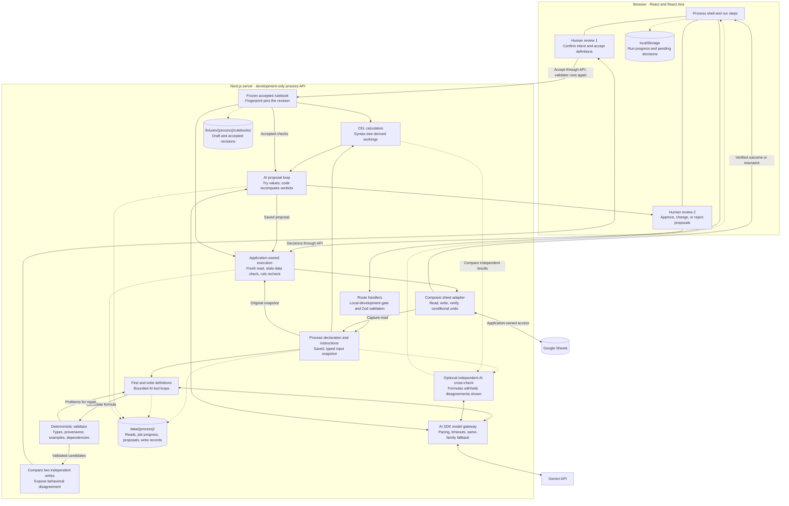

Safepoint is a **human review system for AI-proposed operational changes**. Its most developed workflow takes written business instructions, turns them into executable rules, asks a person to approve those rules, and uses them to check proposed changes before application code writes anything externally.

The most interesting engineering idea is the separation of responsibilities:

> The AI interprets instructions and proposes changes. Deterministic code checks their structure, calculates results, and enforces accepted rules. A person resolves ambiguity and authorizes changes. Application-owned adapters perform and verify the writes.

This analysis describes the working tree on **31 October 2026**, including uncommitted changes, checked against implementation guides, source, tests, and the development log. It is a dated architecture walkthrough, not a replacement for the current [architecture guide](ARCHITECTURE.md) or [definitions engine guide](DEFINITIONS-ENGINE.md). Some overview documentation was behind the code. This was a source analysis: the application and tests were not run, models were not called, and the live sheet was not accessed.

**For another software engineer, I would describe the architecture this way:** Safepoint is a TypeScript modular monolith built on Next.js App Router and React, with a shared process-and-run interface around a generic AI-assisted policy engine. Each process declares its record tables, joins, typed columns, proposal fields, and output destination; the active Brunch orders process joins four Google Sheets tabs by product key and looks up category parameters in a fifth. The server captures a read under an ID, then uses Gemini through the Vercel AI SDK to extract definitions from versioned prose and write them as CEL expressions over a restricted evaluation context. Zod validates the exchanged and stored contracts, while deterministic checks validate formula types, dependencies, quoted constants and groups, worked examples, and behavior on the input records. The model can call tools to try a formula or check a candidate, and the same validator runs again when a person accepts it. An especially interesting detail is that each definition is drafted independently twice and compared behaviorally: disagreement is shown to a person rather than settled by majority vote, because multiple drafts can repeat the same misinterpretation. Accepted rulebooks are frozen as fingerprinted revisions, and calculations execute in code, with readable workings derived from the expression's syntax tree; an optional model cross-check independently recomputes values without seeing the formulas. A separate bounded tool loop proposes changes and tests them against accepted checks, but it has no external write tools. After a second human decision on the actual proposed changes, application code resolves the saved proposal, re-reads the sheet, rejects changed inputs, rechecks time-sensitive rules, writes through an application-owned Composio adapter, and reads back the result; undo restores prior values only if the written block remains untouched. The React frontend composes this into inspectable workflow steps using React Aria controls and a generated semantic styling system, while the older promotion replay reaches shared review components through a domain adapter. The main architectural tradeoff is persistence and execution durability: accepted policies live in versioned JSON files, runtime artifacts live in gitignored files, run progress and pending decisions live in browser storage, and AI jobs run inside the Next.js process with polling and partial-batch recovery. It therefore has substantial policy, inspection, and execution-boundary machinery, while durable workers, authenticated review history, and transactional concurrency remain production work; live sheet write-back is implemented but, as of this analysis, documented as tested only against an in-memory sheet.

The diagram follows the active Brunch workflow. Arrows indicate data or control flow; dashed arrows indicate persistence or optional cross-checking. The two review nodes are separate human decisions.



---

**The project currently contains three different levels of implementation.** Keeping these distinct makes the rest of the architecture easier to explain.

| Area                     | What exists today                                                                                                                                                                       |
| ------------------------ | --------------------------------------------------------------------------------------------------------------------------------------------------------------------------------------- |
| Shared application shell | Process navigation, runs, instructions, inputs, review surfaces, drawers, preferences, and substantial interaction and visual infrastructure                                            |
| Promotion release        | A validated, fictional 27-item replay illustrating evidence, proposals, policy findings, and review                                                                                     |
| Brunch orders            | The active development workflow: sheet reads, AI-generated definitions, individual rule approval, calculations, AI cross-checks, proposals, decisions, write-back, and conditional undo |
| Model workbenches        | Development experiments for structured proposals, evidence extraction, rule drafting, and evaluation                                                                                    |
| Assistant sidebar        | A UI preview; sending messages is disabled                                                                                                                                              |

The Brunch workflow is **development-only**. Its write adapter exists, but the development log says the first real sheet write has not happened; verification so far used an in-memory sheet. Durable multi-user review history is still future work.

The stored state also reflects ongoing development: the v2 rulebook is accepted, while the inspected v3 draft has no approved definitions.

Sources: [architecture guide](ARCHITECTURE.md), [Brunch development log](../processes/brunch-orders/DEVELOPMENT-LOG.md), [assistant preview](../../components/app-shell/assistant/assistant-panel.tsx).

---

**Architecturally, this is a modular monolith inside a Next.js application.** The frontend, HTTP endpoints, domain engine, persistence adapters, and external integrations live in one repository and run within the same application.

```text
Browser
  |
  +-- Process shell
  |     navigation, runs, instructions, inputs, drawers
  |
  +-- Process-specific workflow
  |     read -> rules -> calculate -> propose -> apply
  |
  +-- Browser-local state
        preferences, run progress, proposal decisions
  |
  | HTTP requests / progress polling
  v
Next.js server
  |
  +-- Route handlers
  |     development gate, request schemas, orchestration
  |
  +-- Definitions engine
  |     interpretation, formula validation, calculation,
  |     proposal checking, application preparation
  |
  +-- Model integration ---------> Gemini through AI SDK
  |
  +-- File storage -------------> fixtures/ and data/
  |
  +-- Sheet adapter ------------> Composio -> Google Sheets
```

There is no separate backend service, database-backed job queue, or production review database in this implementation.

The declared stack is:

| Concern                | Implementation                                          |
| ---------------------- | ------------------------------------------------------- |
| Web framework          | Next.js 16, App Router                                  |
| UI                     | React 19, React Aria Components                         |
| Language and contracts | TypeScript with strict checking, Zod                    |
| Styling                | Tailwind CSS 4, plain component-owned CSS               |
| Motion                 | CSS, shared motion utilities, Motion                    |
| AI calls               | Vercel AI SDK 7, Google provider                        |
| Formula evaluation     | CEL through `@marcbachmann/cel-js`                      |
| External sheet access  | Composio                                                |
| Testing                | Vitest, Playwright, axe                                 |
| Additional checks      | Knip, custom token, colour, geometry, and visual checks |

Those versions describe the [repository configuration](../../package.json), not an assessment of current package releases.

---

**The folder structure separates product presentation from domain behavior fairly clearly.**

```text
app/
  (shell)/                    Pages sharing the persistent application shell
    examples/
      promotion/              Recorded promotion review
      brunch-orders/          Active development process
  api/
    dev/brunch-orders/        Read, rules, calculate, propose, apply
    dev/model*/               Model experiments and quota visibility
    replays/...               On-demand replay item details
  workbench/                  UI, motion, colour, and AI laboratories
  styles/                     Shared foundations and generated tokens

components/
  app-shell/
    sidebar/                  Navigation, search, ordering
    process/                  Process header, tabs, settings, panels
    runs/                     Run list, selection, local run storage
    thread/                   Ordered workflow presentation
    inputs/                   Input inspection
    instructions/             Instruction editing and comparison
    assistant/                Assistant preview
  brunch-orders/              Process-specific workflow steps
  review/                     Shared review presentation
  ui/                         Reusable controls and visual primitives
  dev/                        Style inspector and design controls

lib/
  definitions/                Generic AI-assisted rules and proposal engine
  processes/brunch-orders/    Brunch-specific declaration and read adapter
  process/                    Shared process/run/navigation models
  sheets/                     Composio, typed cells, weekly time arithmetic
  promotion-release/          Replay evidence, schemas, domain policy
  review/                     Shared review contracts and adapters
  review-presentation/        Promotion-specific presentation mapping
  model-workbench/            AI experiments and evaluation
  storage/                    Runtime storage locations

fixtures/                     Captured inputs and approved rulebook revisions
replays/                      Recorded proposal and policy outputs
data/                         Gitignored runtime artifacts
e2e/                          Browser tests and frozen test fixtures
scripts/                      Colour generation and structural checks
tools/                        Local build tooling
docs/                         Current guides, process logs, research, archives
```

One useful distinction: `lib/definitions/` is generic, but the current workflow UI and HTTP routes are still explicitly Brunch-specific. The project has generalized its engine further than its application wiring.

---

**The data model has two layers: operational records and the policy used to interpret them.**

At the shell level:

- `ProcessSummary` describes a process, its instructions, schedule configuration, outputs, and runs.
- `ProcessRun` identifies an execution, its trigger, status, counts, and instruction version.
- `ProcessStep` describes an individual step's status, progress, timing, and explanation.
- `InstructionsVersion` retains prose, authorship metadata, reasons for change, and earlier versions.

A run's status is separate from a step's status. A step can finish while the overall run waits for review. The model also distinguishes `superseded` from `failed`: an older proposal can become irrelevant without having failed.

The engine receives a small process contract:

```text
DefinitionProcess
  id
  subject
    record vocabulary        "product", "products"
    reader                   "store owner"
    proposal fields          order: whole-number units
    data shape
      record tables
      join key
      lookup tables
      typed columns
      derived timing columns
      output destination
```

For Brunch orders:

```text
Products ------+
Stock ---------+
Sales ---------+-- join by sku --> record
Deliveries ----+                     |
                                     +-- category lookup --> Parameters
                                     |
                                     +-- proposed order ---> Orders
```

The first record table establishes the record set. Parameters are looked up through each product's category.

The engine's major objects are:

| Object          | What it represents                                                                            |
| --------------- | --------------------------------------------------------------------------------------------- |
| `KeptRead`      | A saved input snapshot, read time, source, sheet metadata, and data tabs                      |
| `Definition`    | One calculation or check, its formula, provenance, examples, dependencies, and approval state |
| `DefinitionSet` | Definitions for one instruction text, with intent and sentence accounting                     |
| `Revision`      | A frozen accepted rulebook, its parent, creation reason, and schema version                   |
| `Calculation`   | Deterministically calculated values and their workings                                        |
| `CrossCheck`    | Independent model calculations and where they agree with code                                 |
| `Proposal`      | Proposed values or an explicit "leave" action for every record                                |
| `Application`   | Decisions applied, before/after cells, verification outcome, and undo state                   |

Sources: [process models](../../lib/process/model.ts), [Brunch declaration](../../lib/processes/brunch-orders/process.ts), [engine contracts](../../lib/definitions/types.ts).

---

**The main workflow separates policy creation from using that policy.**

```text
POLICY CREATION

Versioned instructions + saved read
                 |
                 v
       Find intent and definitions              AI
                 |
                 v
       Write each definition as CEL             AI
                 |
                 v
       Validate, execute examples, compare      Code
                 |
                 v
       Confirm intent and accept definitions    Human
                 |
                 v
       Freeze accepted rulebook revision


RUN EXECUTION

Saved read + accepted rulebook
                 |
                 v
       Calculate values                         Code
                 |
                 +--> Independent cross-check   AI
                 |
                 v
       Propose values for every record          AI
                 |
                 v
       Re-evaluate accepted checks              Code
                 |
                 v
       Approve / change / reject                Human
                 |
                 v
       Fresh read and execution checks          Code
                 |
                 v
       Write -> read back -> record outcome     Adapter + code
```

The distinction matters because accepting a rule means "this is how we interpret the policy," while approving a proposal means "apply this particular change."

Once accepted, formulas can be reused without asking a model to reinterpret the business instructions on every calculation.

---

**The AI system is a bounded workflow with several specific jobs.** Its active path is implemented with AI SDK calls and explicit tool loops.

| AI stage                 | Input                                                                 | Output                                                | Available model tools               |
| ------------------------ | --------------------------------------------------------------------- | ----------------------------------------------------- | ----------------------------------- |
| Find definitions         | Instructions and available data columns                               | Intent, ordered definitions, sentence accounting      | Structured output                   |
| Write a definition       | Instructions, real records, earlier definitions and calculated values | CEL formula, quoted constants/groups, worked examples | `try_formula`, `check_definition`   |
| Cross-check calculations | Instructions, data, plain-language calculation descriptions           | Independently calculated values and working           | Structured output                   |
| Propose changes          | Instructions, accepted checks, calculated values, data                | Values or "leave," reasons, citations, uncertainty    | `try_proposals`, `submit_proposals` |

None of these model tools can write to Google Sheets. They evaluate candidates or submit structured proposals to application code.

The prompts and schemas are generated from the process declaration. Terms such as "product," "order," and "store owner" enter through that declaration rather than being built into the generic engine.

**Finding definitions includes an explicit completeness check.** The server breaks instructions into numbered sentences or list items. The model must classify each as:

- A quantity or calculation.
- A check.
- Context.

It must link relevant sentences to definitions. Code rejects missing or duplicate sentence references, nonexistent definitions, and inconsistent classifications. A failed answer gets one corrective attempt.

This addresses omission, but it cannot establish semantic correctness: the model can still account for a rule by wrongly calling it context. The UI exposes what was set aside so a person can inspect that decision.

Source: [definition discovery](../../lib/definitions/find.ts).

---

**A definition is effectively a small, reviewable program.** It has either a numeric result or a boolean result.

Examples present in the stored rules include:

```text
Calculation:
  record.on_hand - record.reserved + record.inbound_before_start

Whole-case check:
  order % record.case_size == 0

Supplier maximum check:
  !has(record.max_order_units) || order <= record.max_order_units
```

A formula can read:

```text
key                  Current record identifier
record.*             Joined input columns
category.*           A process-declared lookup
order                A process-declared proposal field
values.*             Earlier definitions
constants.*          Numbers grounded in quoted instructions
groups.*             Named sets grounded in quoted instructions
```

The choice of CEL gives the model an expression language with a controlled context. The application does not execute generated JavaScript.

Several implementation details make this more substantial than "ask for JSON and trust it":

- Formulas are parsed and type-checked before examples run.
- Unknown variables and fields are rejected.
- Integer and decimal types remain distinct.
- Blank cells are absent values, tested with `has(...)`.
- Dependencies can reference only earlier definitions.
- Formula complexity is capped at 300 syntax-tree nodes.
- Compiled formulas are cached.
- Rounding helpers compensate for decimal noise before rounding.
- `ceil`, `floor`, and `round` require decimal inputs, avoiding silently truncated integer division.

The record adapter also normalizes types consistently across rows. A column containing both integers and decimals becomes consistently decimal for formula checking.

Source: [formula runtime](../../lib/definitions/formulas.ts).

---

**The model writes against the same validator that later governs acceptance.** This is one of the strongest architectural choices.

The writing loop works approximately like this:

```text
Model submits a definition
           |
           v
check_definition
  - validate provenance
  - check syntax and types
  - validate dependencies
  - execute examples
  - try every record
  - check useful pass/fail coverage
           |
       problems?
       /       \
     yes        no
      |          |
      v          v
Model repairs   Keep candidate
```

The validator checks, among other things:

- Quoted constants occur in the instructions and actually state their values.
- Named groups contain known records with supporting words.
- Policy numbers are declared constants rather than hidden formula literals.
- Record keys are not hard-coded as special cases.
- Declared constants and groups are actually used.
- Examples cover inside and outside a referenced group.
- The formula's results agree with the examples.
- The formula runs on every record at the validation input.
- A check can pass on the probed data and shows failure examples where reachable.

Writing is bounded: at most 12 model steps for one write, with early stopping on success, broken dependencies, or three repeated problem sets.

When a person clicks Accept, the server runs the review again against the saved read. It does not trust the browser's indication that a card looks acceptable.

Rewriting a definition, or choosing a different candidate version, clears approvals from definitions that depend on it.

Sources: [shared checks](../../lib/definitions/checks.ts), [writing loop](../../lib/definitions/write.ts), [acceptance](../../lib/definitions/decide.ts).

---

**Independent drafting is used to expose ambiguity.** Each definition is written twice from the same input, without either write seeing the other.

Code compares the resulting formulas on real records across a range of proposal values.

```text
Same input
   |
   +--> Write A --> checks --+
   |                        |
   +--> Write B --> checks --+--> compare behavior
                                      |
                            +---------+----------+
                            |                    |
                         agrees               differs
                            |                    |
                     show candidate       show differences
                                           person chooses
```

A third write is used when a candidate fails validation, to try to obtain two valid candidates. It is not used as a deciding vote when two valid formulas disagree.

That choice came from a documented experiment: a majority vote sometimes selected a repeated misreading. The implementation therefore preserves disagreement as useful evidence.

There are precise limits to this:

- Two independent writes can make the same mistake.
- Comparing sampled inputs is not proof of equivalence.
- If only one valid candidate is available, it is marked `unconfirmed`; that status is not itself an absolute acceptance block.
- `split` candidates require a person to choose before acceptance.

This is a practical uncertainty mechanism, not a correctness guarantee.

---

**Calculation and AI cross-checking are deliberately independent.** Code executes the accepted numeric definitions in order. The model separately works out the same values using the instructions and data, without seeing the formulas.

The code result remains the operative result. Disagreement is shown to a person; there is no automatic vote or model override.

Cross-checks run in batches of 25 records. Each completed batch is saved, allowing an interrupted request to resume with the remaining records. Results are associated with the saved read and rulebook fingerprint.

One useful nuance: the UI allows proposal generation after calculation even if the optional cross-check is incomplete or disagrees. Cross-checking is diagnostic, rather than a universal execution gate.

The explanations attached to code calculations are also noteworthy. `working.ts` walks the formula's syntax tree to produce intermediate steps. This means the arithmetic shown to the reviewer derives from what actually ran, rather than from a separate model-written explanation.

Sources: [calculation and cross-checking](../../lib/definitions/calculate.ts), [formula workings](../../lib/definitions/working.ts).

---

**Proposal generation gives the model a safe environment for trying changes.**

`try_proposals` lets it test values for multiple records at once. The tool returns each accepted check's outcome and working.

`submit_proposals` requires complete coverage of the requested records. The application validates citations and recomputes verdicts itself:

| Verdict   | Meaning                                                  |
| --------- | -------------------------------------------------------- |
| `ready`   | No evaluated check failed                                |
| `decide`  | A check failed whose consequence requires human judgment |
| `blocked` | A check failed whose consequence prohibits application   |

A structurally valid proposal may still contain blocked records. That is intentional: the reviewer should see conflicts and omissions rather than have difficult records disappear.

Every record carries an action, values where applicable, a reason, cited cells, and uncertainty. Proposal generation also uses 25-record batches, saves partial results, and has a bounded 24-step tool loop per batch.

There is a distinction worth retaining when discussing the design: an explicit `leave` action currently receives no proposal checks. It should not be interpreted as evidence that every data-quality rule passed for that record.

Source: [proposal generation and checking](../../lib/definitions/propose.ts).

---

**The execution boundary reconstructs changes from server-held evidence.** The browser sends decisions, but an ordinary approval gets its values from the saved proposal.

Before a write, the server:

1. Resolves the saved read and rulebook.
2. Checks whether the accepted formulas still fit the read's types.
3. Confirms decisions refer to the current proposal timestamp.
4. Requires every proposal record to have a decision.
5. Refuses captured reads and runs on earlier instructions.
6. Reads the sheet again.
7. Refuses changed input data.
8. Re-evaluates checks using the fresh read time.
9. Refuses blocking failures.
10. Requires explicit acknowledgment of newly failing human-decision checks.

The time re-evaluation matters. A proposal can be valid when reviewed and invalid later because a supplier cutoff has passed, even if no cell changed.

The adapter writes a rectangular range, reads it back, and records one of three outcomes:

- `verified`: the intended values were observed.
- `failed`: the original values were observed.
- `mismatch`: the observed state differs or cannot be established as either.

Undo restores the prior block only while the block still equals the application's recorded result. It then verifies the restoration. This is conditional compensation, not a transaction rollback.

The current implementation does not provide a distributed transaction between the sheet and its local application record. Read-before-write checks also do not eliminate concurrent changes between those requests. Those are production-hardening boundaries.

Sources: [application engine](../../lib/definitions/apply.ts), [apply endpoint](../../app/api/dev/brunch-orders/apply/route.ts), [Composio adapter](../../lib/sheets/composio.ts).

---

**Persistence distinguishes accepted policy from runtime evidence, but remains development storage.**

```text
fixtures/brunch-orders/
  sheet-snapshot.json

  rulebooks/<version>-<instructions-hash>/
    current.json             Mutable draft under review
    <fingerprint>.json       Frozen accepted revision
    revisions.json           Parent links, reasons, current head

data/brunch-orders/
  reads/                     Saved input snapshots
  drafts/                    Draft job progress
  cross-checks/              Completed and partial cross-checks
  proposals/                 Completed and partial proposals
  applied/                   Write outcomes and before/after blocks

Browser localStorage
  Run list and progress
  Proposal decisions before application
  Preferences and process configuration
```

Instruction text is identified by a hash. Accepted rulebooks receive a fingerprint, and runs can pin that revision so subsequent drafting does not silently replace their formulas.

Stored rulebooks are validated through Zod. Important saves use temporary files followed by rename, reducing the risk of a partially written JSON file. Revision access is centralized in `store.ts`, giving a future database implementation a reasonably clear replacement boundary.

However, atomic file replacement is not the same as transactional multi-user persistence. Read-modify-write operations and revision/index updates do not become concurrency-safe merely because each file write is atomic.

Source: [rulebook storage](../../lib/definitions/store.ts).

---

**Long-running AI work has practical recovery, but no durable workflow runtime.**

Draft and proposal jobs run inside the Next.js server process. A `globalThis` map retains their live status across development module reloads, while progress is also written to disk. The UI polls roughly every two seconds.

Closing the browser does not necessarily stop a job. Stopping the server does. On restart, a saved "running" job is reported as interrupted rather than pretending it is still active. Proposal and cross-check batches can reuse completed partial results.

The main definitions pipeline also wraps model requests with:

- Per-request pacing, including each request inside a tool loop.
- Limits learned from provider refusals.
- Temporary waits for short quota windows.
- Limited retries for busy providers.
- Model fallback within the selected family.
- Development telemetry and visible quota information.

The default policy uses Flash for discovery and proposal-related work, and Flash-Lite for repeated formula writing. This is explicitly chosen orchestration; fallback does not silently switch from the selected family to a lighter family.

The older model-workbench experiments have their own direct provider calls, so the central pacing layer should be understood as the main engine's infrastructure, not necessarily every model request in the repository.

Sources: [draft jobs](../../lib/definitions/draft.ts), [model call orchestration](../../lib/definitions/calls.ts), [request pacing](../../lib/definitions/limits.ts).

---

**The frontend is organized around processes and runs rather than a chat transcript.**

```text
Persistent application shell
  |
  +-- Process navigation
  |
  +-- Process page
        |
        +-- Header and configuration panels
        +-- Instructions / inputs / rules
        +-- Run selection
        +-- Run thread
              |
              +-- Instructions
              +-- Read
              +-- Rules
              +-- Calculate
              +-- Propose and decide
              +-- Apply and inspect outcome
```

The shared shell lives in a Next.js layout so navigation does not remount it and reset sidebar measurements or menu state.

Server components load and prepare data where appropriate. Client components own interaction state, selection, resizing, drawers, and the live workflow. For example, the shell sends lightweight navigation summaries across the client boundary rather than full review plans.

Local persistence uses a shared `createStoredRecord` abstraction with `useSyncExternalStore`:

- Same-tab changes dispatch a custom event.
- Other tabs receive browser storage events.
- Invalid stored values fall back safely.
- Failed localStorage writes fall back to memory.
- Certain preferences also use cookies so the server's first render matches them.

The Brunch workflow composes individual step components and derives their status from progress. That keeps the operational sequence visible, though some step components have become large and mix fetching, state, and detailed presentation.

Sources: [persistent shell layout](<../../app/(shell)/layout.tsx>), [browser storage abstraction](../../components/app-shell/stored-record.ts), [Brunch run composition](../../components/brunch-orders/orders-run.tsx).

---

**The promotion replay provides a separate, reusable review presentation model.**

Its flow is:

```text
Evidence fixtures + recorded agent proposal + policy evaluation
                              |
                              v
                    Validated review lines
                              |
                              v
                  Domain presentation adapter
                              |
                              v
                   ReleasePlan / ReviewDetail
                              |
                              v
                 Shared cards, queues, drawers
```

A `ReleasePlan` contains effects, structured changes, reasons, dispositions, and overall state. Its deltas can express numeric changes, categorical changes, creation, deletion, set changes, or an opaque fallback.

Some thoughtful contract decisions:

- An unknown previous value is distinct from creating something new.
- Unknown change kinds have a display fallback, while malformed known kinds still fail validation.
- Counts derive from effects instead of being stored independently.
- Excluding blocked items from the current selection does not erase their presence from the evaluated plan.
- Grouping by reason does not pool evidence across records.
- Replay mode prevents the UI from implying live operations it cannot perform.

This contract is a presentation boundary, not execution authorization.

The Brunch flow has not fully converged on it: its detailed proposal review is process-specific, while its shared navigation plan remains an incomplete placeholder. There are currently two related review paths rather than one universal end-to-end framework.

Source: [shared review contract](../../lib/review/plan-contract.ts).

---

**The design system is unusually engineered for a prototype.** It treats visual consistency as a set of inspectable and testable rules.

The system uses:

- One CSS entry point with explicit cascade order.
- Shared foundations under `app/styles/`.
- Plain component-owned CSS beside TSX files.
- Semantic colour roles instead of direct Tailwind palette colours.
- Generated neutral ramps and Radix hue scales.
- Surface-relative colour roles that adapt to their containing surface.
- Checks against missing, unused, or overly indirect tokens.

The developer tooling is especially distinctive:

- An in-app inspector links an element to its React source and style definitions.
- Workbench pages expose controls, colours, motion, and loading states.
- A token tracer explains where a role is declared and how it resolves.
- Sidebar alignment is measured against axes defined by the live CSS.
- Visual checks compare painted colours and geometry.
- Colour checks include contrast and perceptual behavior.

Development uses webpack specifically to retain useful CSS source maps and support a local PostCSS transformation. Production builds remain configured for Turbopack.

Motion also follows explicit rules: shared timing tokens, measured distances, coordinated settling, reduced-motion fallbacks, and sequencing from actual animation completion rather than duplicated timeout values.

Source: [styling system](../interface/STYLING-SYSTEM.md).

---

**The engineering workflow emphasizes reproducible evidence.**

Vitest tests cover formula checking, approval invalidation, revision storage, time arithmetic, proposal coverage, quota behavior, write verification, and undo refusal. Model tests use stand-ins and scratch directories rather than spending quota or rewriting accepted fixtures.

Playwright covers navigation, focus, run transitions, review surfaces, Brunch stages, motion, colour behavior, and developer tools. Browser tests use frozen rulebooks because the real drafting workflow changes stored state.

CI runs linting, typechecking, formatting, unit tests, token and colour checks, unused-code checks, builds, and browser tests. The font-sensitive visual baseline remains local. These are checks configured in the repository, not checks executed for this analysis.

The development log is particularly valuable: it records failed hypotheses and the resulting design changes. Examples include missing rules in prose, rounding errors that agreed with model-written examples, ambiguous meanings of "stock," and a cutoff rule that looked valid until replayed at a later time.

That history explains why the architecture prioritizes inspectable formulas and disagreement signals.

Sources: [CI configuration](../../.github/workflows/checks.yml), [Brunch development log](../processes/brunch-orders/DEVELOPMENT-LOG.md).

---

**The main limitations are clear enough to discuss candidly with another engineer.**

| Boundary             | Current limitation                                                                                             |
| -------------------- | -------------------------------------------------------------------------------------------------------------- |
| Semantic correctness | Checks prove constrained properties; they cannot prove the formula means what the author intended              |
| Independent drafting | Shared mistakes and untested input values can escape comparison                                                |
| Rule completeness    | Sentence accounting can still misclassify a quantity or rule as context                                        |
| Generality           | Checks operate per record; proposal fields are whole numbers                                                   |
| Data freshness       | Stock observations expressed only as weekdays cannot reveal that a count is weeks old                          |
| Identity             | There is no sign-in or authoritative reviewer identity                                                         |
| Review persistence   | Decisions remain browser-local until an application record is written                                          |
| Job durability       | Work runs in-process; there is no durable worker or queue                                                      |
| External execution   | Live write-back is implemented but not yet demonstrated in the development log                                 |
| Concurrency          | Sheet checks and local files do not provide transactional multi-user execution                                 |
| Product integration  | The generic review contract and Brunch workflow are not fully unified                                          |
| Scheduling and chat  | Visible configuration and preview UI should not be mistaken for a production scheduler or conversational agent |

The [development API guard](../../lib/dev/dev-route.ts) checks development mode, loopback host, and request origin before provider access. That is an appropriate local development boundary; it is not a substitute for production authentication and authorization.

**The strongest way to present this project is through three concrete engineering achievements:** compiling prose into inspectable executable policy, preserving uncertainty for human judgment, and keeping model reasoning separate from external write authority.

A compact explanation to use in conversation:

> Safepoint is a Next.js review application with an AI-assisted rules engine. A process declares its data shape and proposal fields. The model extracts definitions from instructions and writes CEL formulas, which code validates against types, provenance, examples, and real records. We draft definitions independently twice to expose disagreements, then a person accepts the policy. Accepted formulas calculate values and check AI proposals. A second human decision authorizes individual changes, and application code re-reads the source, rechecks the rules, writes through a controlled adapter, and verifies the result. The current implementation uses local files and browser state, so the policy and execution boundaries are further developed than the production persistence and job infrastructure.
