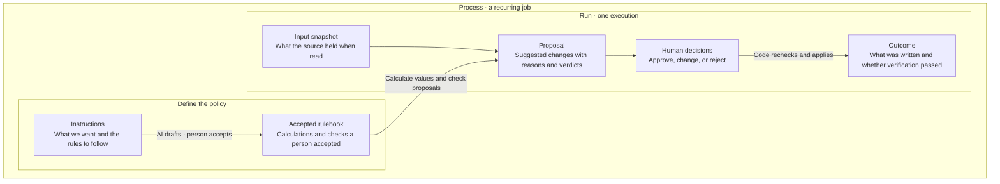
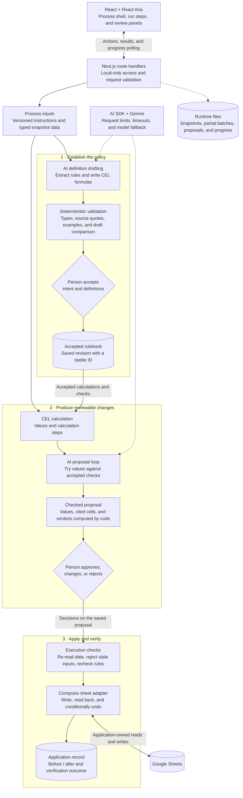
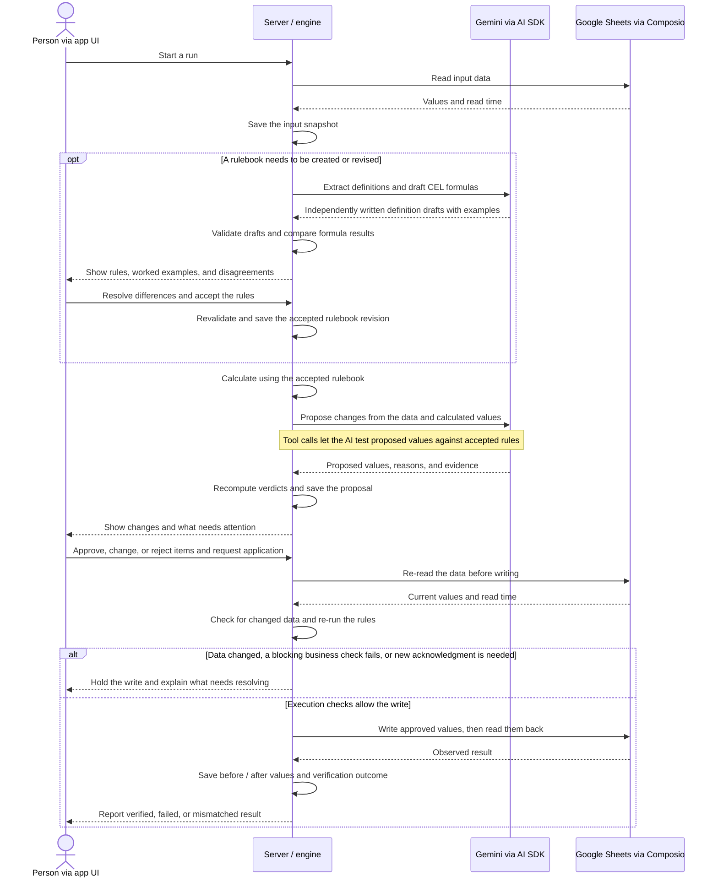

Safepoint is a **human review system for AI-proposed operational changes**. Its most developed workflow takes written business instructions, turns them into executable rules, asks a person to approve those rules, and uses them to check proposed changes before application code writes anything externally.

The most interesting engineering idea is the separation of responsibilities:

> The AI interprets instructions and proposes changes. Deterministic code checks their structure, calculates results, and enforces accepted rules. A person resolves ambiguity and authorizes changes. Application-owned adapters perform and verify the writes.

This analysis describes the working tree on **31 October 2026**, including uncommitted changes, checked against implementation guides, source, tests, and the development log. It is a dated architecture walkthrough, not a replacement for the current [architecture guide](ARCHITECTURE.md) or [definitions engine guide](DEFINITIONS-ENGINE.md). Some overview documentation was behind the code. This was a source analysis: the application and tests were not run, models were not called, and the live sheet was not accessed.

**The main terms distinguish policy from proposed changes.**

| Term                            | Meaning in this document                                                                                                                                                |
| ------------------------------- | ----------------------------------------------------------------------------------------------------------------------------------------------------------------------- |
| Process / run                   | A process defines a repeatable job. A run is one execution of that job, using particular instructions, data, and rules.                                                 |
| Record                          | One item the process works on. In Brunch orders, this is one product, identified by `sku`, with data joined from several tabs.                                          |
| Definition                      | One named calculation or business check extracted from the instructions, such as expected sales or ordering in whole cases.                                             |
| Definition draft                | A proposed implementation of one definition: a formula, its constants and named groups, and worked examples. It has not necessarily passed validation or been accepted. |
| Rulebook / policy               | The rulebook collects the definitions for an instruction version. Once accepted, it is the executable policy used to calculate values and check proposed changes.       |
| Proposal / proposed values      | A proposal covers the records in a run. For each record it suggests values to set, such as `order = 24`, or explicitly says to leave it unchanged.                      |
| Input snapshot / saved read     | The saved data returned by a read, with its read time and source. A live read fetches the sheet now; a captured read loads a previously saved fixture for development.  |
| Rulebook revision / fingerprint | A revision is a saved accepted rulebook that is not rewritten. Its fingerprint is a hash-based identifier used to retrieve that version.                                |
| Application record              | The record of an attempted external write: decisions, before/after values, and the read-back verification outcome.                                                      |

A **definition draft** describes how to calculate or check something; **proposed values** describe what to change for a particular record. For example, `order % record.case_size == 0` is a draft formula for the whole-case rule, while `order = 24` is a proposed value to test against that rule. Two drafts of that definition are alternative implementations of the same rule, not two products or two order proposals.

There are also two kinds of checking: **definition validation** checks a draft's syntax, types, supporting quotes, and examples; a **business check** is a boolean formula that tests a record or its proposed values. Business checks must be accepted before they are used to evaluate proposals. Passing definition validation does not prove that a formula correctly interprets the instructions.

**For another software engineer, I would describe the architecture this way:** Safepoint is a TypeScript modular monolith—a single Next.js application with separate modules for the interface, domain logic, storage, and external integrations. Its React interface presents processes and their runs around a reusable AI-assisted rules engine. Each process declares its tables, join keys, column types, proposal fields, and output destination; Brunch orders joins four Google Sheets tabs by product key and looks up category parameters in a fifth. The server saves an input snapshot, then uses Gemini through the Vercel AI SDK to extract definitions from versioned instructions and write formulas in Common Expression Language (CEL). Zod schemas check the structure of requests, model answers, and stored rulebooks. Code validates each draft formula's types, references to earlier definitions, supporting instruction quotes, and worked examples. The model can call server functions to try a formula or validate the complete definition draft, and the server repeats validation when a person accepts it. The engine tries to obtain two independently written, valid drafts of each definition and compares their results on sampled inputs. Neither draft sees the other's answer; disagreement goes to a person because a majority vote can repeat the same misinterpretation. Accepted rulebooks are saved as revisions identified by a fingerprint. Code executes their calculations and derives readable intermediate steps from the parsed formulas; an optional model cross-check recomputes values without seeing those formulas. Another model conversation, limited by step counts and timeouts, proposes record changes and tries values against the accepted business checks. A person then approves, changes, or rejects those proposals. Application code loads the saved proposal, re-reads the sheet, refuses changed inputs or blocking rule failures, and writes through its Composio integration. It reads the written cells back to verify the result, and undo restores prior values only while the block still holds what was written. The interface uses React Aria controls and generated style tokens; the older promotion replay converts its domain-specific data into shared review components. The main remaining infrastructure work is persistence and job durability: rulebooks and runtime results use local JSON files, run progress and pending decisions also use browser storage, and background jobs run inside Next.js. This gives the project detailed policy review and write checks, while authenticated review history, restart-safe workers, and protection against concurrent writes remain production work. As of the source analysis, sheet write-back was implemented but documented as tested only with an in-memory sheet.

**The app revolves around a process and its runs.** A process is a repeatable job with reusable instructions and a rulebook that a person reviews and accepts. Each run reads data, proposes changes, asks for decisions, and records the outcome. These diagrams are conceptual maps: they group implementation details to make the main relationships easier to follow.



The two approval moments answer different questions: **accepting a rulebook** agrees how the process should work; **approving a proposal** authorizes particular changes. The outcome records what actually happened, including failures or mismatches when a write cannot be verified.

**The technical view separates policy drafting, proposal generation, and execution.** The main path shows how a saved read becomes a checked proposal, followed by a write attempt and verification. The two diamonds are human decisions made in the React interface; dashed connections show supporting infrastructure. The groups describe responsibilities inside the Next.js application, not separate services.



The validator also feeds problems back into drafting; `try_formula` and `check_definition` let the model repair its definition drafts. Proposal generation uses `try_proposals` and `submit_proposals`, with code recomputing the final verdicts. Those local loops are folded into their boxes to keep the main path legible. Calculation can also request an independent AI cross-check without showing the model the formulas.

The saved read and accepted rulebook remain inputs throughout proposal and execution, although their arrows are shown only at the start of that path. The runtime-files arrow represents file access from several server modules. Rulebooks and runtime results live in server-side files; run progress and pending decisions also use browser storage. Background jobs run inside the Next.js process, with completed batches saved so interrupted work can resume. External writes belong exclusively to application code.

**The same workflow, shown as a sequence, makes the handoffs clearer.** This is the live-read path, with the person and app UI combined into one lane and storage operations represented by the server lane. Rulebook drafting is needed only when there is no suitable accepted rulebook; later runs reuse it.



The two human approvals are distinct: one accepts the rulebook, the other authorizes specific changes. Draft repair loops, optional AI cross-checking, batch recovery, and progress polling are omitted from this sequence. The AI never writes to the sheet; the application owns execution and verification.

---

**The project contains several areas at different stages of implementation.** Keeping these distinct makes the rest of the architecture easier to explain.

| Area                     | What exists today                                                                                                                                                                       |
| ------------------------ | --------------------------------------------------------------------------------------------------------------------------------------------------------------------------------------- |
| Shared application shell | Process navigation, runs, instructions, inputs, review surfaces, drawers, preferences, and substantial interaction and visual infrastructure                                            |
| Promotion release        | A saved, fictional 27-item example showing source data, model proposals, business-check results, and review                                                                             |
| Brunch orders            | The active development workflow: sheet reads, AI-generated definitions, individual rule approval, calculations, AI cross-checks, proposals, decisions, write-back, and conditional undo |
| Model workbenches        | Development experiments for structured proposals, evidence extraction, rule drafting, and evaluation                                                                                    |
| Assistant sidebar        | A UI preview; sending messages is disabled                                                                                                                                              |

The Brunch workflow is **development-only**. Its write adapter exists, but the development log says the first real sheet write has not happened; verification so far used an in-memory sheet. Durable multi-user review history is still future work.

At the time of the source analysis, the stored v2 rulebook was accepted, while the inspected v3 draft had no approved definitions.

Sources: [architecture guide](ARCHITECTURE.md), [Brunch development log](../processes/brunch-orders/DEVELOPMENT-LOG.md), [assistant preview](../../components/app-shell/assistant/assistant-panel.tsx).

---

**Architecturally, this is a modular monolith inside a Next.js application.** The frontend, HTTP endpoints, domain engine, persistence adapters, and external integrations live in one repository and run within the same application.

```text
Browser
  |
  +-- Process shell
  |     navigation, runs, instructions, inputs, drawers
  |
  +-- Process-specific workflow
  |     read -> rules -> calculate -> propose -> apply
  |
  +-- Browser-local state
        preferences, run progress, proposal decisions
  |
  | HTTP requests / progress polling
  v
Next.js server
  |
  +-- Route handlers
  |     local-only access, request validation, coordination
  |
  +-- Definitions engine
  |     interpretation, formula validation, calculation,
  |     proposal checking, application preparation
  |
  +-- Model integration ---------> Gemini through AI SDK
  |
  +-- File storage -------------> fixtures/ and data/
  |
  +-- Sheet adapter ------------> Composio -> Google Sheets
```

There is no separate backend service, database-backed job queue, or production review database in this implementation.

The declared stack is:

| Concern                | Implementation                                          |
| ---------------------- | ------------------------------------------------------- |
| Web framework          | Next.js 16, App Router                                  |
| UI                     | React 19, React Aria Components                         |
| Language and contracts | TypeScript with strict checking, Zod                    |
| Styling                | Tailwind CSS 4, plain component-owned CSS               |
| Motion                 | CSS, shared motion utilities, Motion                    |
| AI calls               | Vercel AI SDK 7, Google provider                        |
| Formula evaluation     | CEL through `@marcbachmann/cel-js`                      |
| External sheet access  | Composio                                                |
| Testing                | Vitest, Playwright, axe                                 |
| Additional checks      | Knip, custom token, colour, geometry, and visual checks |

Those versions describe the [repository configuration](../../package.json), not an assessment of current package releases.

---

**The folder structure separates product presentation from domain behavior fairly clearly.**

```text
app/
  (shell)/                    Pages sharing the persistent application shell
    examples/
      promotion/              Recorded promotion review
      brunch-orders/          Active development process
  api/
    dev/brunch-orders/        Read, rules, calculate, propose, apply
    dev/model*/               Model experiments and quota visibility
    replays/...               On-demand replay item details
  workbench/                  UI, motion, colour, and AI laboratories
  styles/                     Shared foundations and generated tokens

components/
  app-shell/
    sidebar/                  Navigation, search, ordering
    process/                  Process header, tabs, settings, panels
    runs/                     Run list, selection, local run storage
    thread/                   Ordered workflow presentation
    inputs/                   Input inspection
    instructions/             Instruction editing and comparison
    assistant/                Assistant preview
  brunch-orders/              Process-specific workflow steps
  review/                     Shared review presentation
  ui/                         Reusable controls and visual primitives
  dev/                        Style inspector and design controls

lib/
  definitions/                Generic AI-assisted rules and proposal engine
  processes/brunch-orders/    Brunch-specific declaration and read adapter
  process/                    Shared process/run/navigation models
  sheets/                     Composio, typed cells, weekly time arithmetic
  promotion-release/          Replay evidence, schemas, domain policy
  review/                     Shared review contracts and adapters
  review-presentation/        Promotion-specific presentation mapping
  model-workbench/            AI experiments and evaluation
  storage/                    Runtime storage locations

fixtures/                     Captured inputs and approved rulebook revisions
replays/                      Recorded proposal and policy outputs
data/                         Gitignored runtime results
e2e/                          Browser tests and frozen test fixtures
scripts/                      Colour generation and structural checks
tools/                        Local build tooling
docs/                         Current guides, process logs, research, archives
```

One useful distinction: `lib/definitions/` is generic, but the current workflow UI and HTTP routes are still explicitly Brunch-specific. The project has generalized its engine further than its application wiring.

---

**The data model has two layers: operational records and the policy used to interpret them.**

At the shell level:

- `ProcessSummary` describes a process, its instructions, schedule configuration, outputs, and runs.
- `ProcessRun` identifies an execution, its trigger, status, counts, and instruction version.
- `ProcessStep` describes an individual step's status, progress, timing, and explanation.
- `InstructionsVersion` retains prose, authorship metadata, reasons for change, and earlier versions.

A run's status is separate from a step's status. A step can finish while the overall run waits for review. The model also distinguishes `superseded` from `failed`: an older proposal can become irrelevant without having failed.

The engine receives a process declaration: a typed configuration describing the data and vocabulary it should use.

```text
DefinitionProcess
  id
  subject
    record vocabulary        "product", "products"
    reader                   "store owner"
    proposal fields          order: whole-number units
    data shape
      record tables
      join key
      lookup tables
      typed columns
      derived timing columns
      output destination
```

For Brunch orders:

```text
Products ------+
Stock ---------+
Sales ---------+-- join by sku --> record
Deliveries ----+                     |
                                     +-- category lookup --> Parameters
                                     |
                                     +-- proposed order ---> Orders
```

The Products tab determines which products are included. The other record tabs are joined by `sku`; each product's `category` selects its row in Parameters.

The engine's major objects are:

| Object          | What it represents                                                                                             |
| --------------- | -------------------------------------------------------------------------------------------------------------- |
| `KeptRead`      | A saved input snapshot, read time, source, sheet metadata, and data tabs                                       |
| `Definition`    | One calculation or business check, with its formula, source quotes, examples, dependencies, and approval state |
| `DefinitionSet` | Definitions for one instruction text, its stated goal, and the classification of every sentence                |
| `Revision`      | Metadata for a saved accepted rulebook: its previous revision, creation reason, and stored-format version      |
| `Calculation`   | Values calculated by code, with intermediate steps                                                             |
| `CrossCheck`    | Independent model calculations and where they agree with code                                                  |
| `Proposal`      | Proposed values or an explicit "leave" action for every record                                                 |
| `Application`   | Decisions applied, before/after cells, verification outcome, and undo state                                    |

Sources: [process models](../../lib/process/model.ts), [Brunch declaration](../../lib/processes/brunch-orders/process.ts), [engine contracts](../../lib/definitions/types.ts).

---

**The main workflow separates policy creation from using that policy.**

```text
POLICY CREATION

Versioned instructions + saved read
                 |
                 v
       Find intent and definitions              AI
                 |
                 v
       Write each definition as CEL             AI
                 |
                 v
       Validate, execute examples, compare      Code
                 |
                 v
       Confirm intent and accept definitions    Human
                 |
                 v
       Freeze accepted rulebook revision


RUN EXECUTION

Saved read + accepted rulebook
                 |
                 v
       Calculate values                         Code
                 |
                 +--> Independent cross-check   AI
                 |
                 v
       Propose values for every record          AI
                 |
                 v
       Re-evaluate accepted checks              Code
                 |
                 v
       Approve / change / reject                Human
                 |
                 v
       Fresh read and execution checks          Code
                 |
                 v
       Write -> read back -> record outcome     Adapter + code
```

The distinction matters because accepting a rule means "this is how we interpret the policy," while approving a proposal means "apply this particular change."

Once accepted, formulas can be reused without asking a model to reinterpret the business instructions on every calculation.

---

**The AI system performs several specific jobs with step limits and timeouts.** A tool is a server function the model can request, such as evaluating a formula. A tool loop alternates model responses and function results so the model can inspect problems and try again. Structured output instead asks the model for a response matching a supplied data schema.

| AI stage                 | Input                                                                 | Output                                                | Available model tools               |
| ------------------------ | --------------------------------------------------------------------- | ----------------------------------------------------- | ----------------------------------- |
| Find definitions         | Instructions and available data columns                               | Intent, ordered definitions, sentence accounting      | Structured output                   |
| Write a definition       | Instructions, real records, earlier definitions and calculated values | CEL formula, quoted constants/groups, worked examples | `try_formula`, `check_definition`   |
| Cross-check calculations | Instructions, data, plain-language calculation descriptions           | Independently calculated values and working           | Structured output                   |
| Propose changes          | Instructions, accepted checks, calculated values, data                | Values or "leave," reasons, citations, uncertainty    | `try_proposals`, `submit_proposals` |

None of these model tools can write to Google Sheets. They evaluate definition drafts or trial proposal values, and submit proposals to application code.

The prompts and schemas are generated from the process declaration. Terms such as "product," "order," and "store owner" enter through that declaration rather than being built into the generic engine.

**Finding definitions includes an explicit completeness check.** The server breaks instructions into numbered sentences or list items. The model must classify each as:

- A quantity or calculation.
- A check.
- Context.

It must link relevant sentences to definitions. Code rejects missing or duplicate sentence references, nonexistent definitions, and inconsistent classifications. A failed answer gets one corrective attempt.

This addresses omission, but it cannot establish semantic correctness: the model can still account for a rule by wrongly calling it context. The UI exposes what was set aside so a person can inspect that decision.

Source: [definition discovery](../../lib/definitions/find.ts).

---

**A definition combines a plain-language meaning with a small executable formula.** A calculation returns a number, such as expected sales. A business check returns true or false, such as whether an order is a whole number of cases. Its examples record input values, the result the model expected, the result code produced, and whether the two agree.

Examples present in the stored rules include:

```text
Calculation:
  record.on_hand - record.reserved + record.inbound_before_start

Whole-case check:
  order % record.case_size == 0

Supplier maximum check:
  !has(record.max_order_units) || order <= record.max_order_units
```

A formula can read:

```text
key                  Current record identifier
record.*             Joined input columns
category.*           A process-declared lookup
order                A process-declared proposal field
values.*             Earlier definitions
constants.*          Numbers grounded in quoted instructions
groups.*             Named sets grounded in quoted instructions
```

A **constant** names a number from the instructions, such as `kits_count = 40` supported by the words “40 kits.” A **group** names a set of record keys, such as the products described as kit ingredients. Keeping these separate from the formula lets a reviewer inspect where its numbers and product selections came from. A **dependency** is an earlier definition whose result the formula reads through `values.<id>`.

CEL formulas can read only the variables and functions made available by the engine. The application does not execute generated JavaScript.

The engine applies several checks and evaluation rules:

- Formulas are parsed and type-checked before examples run.
- Unknown variables and fields are rejected.
- Integer and decimal types remain distinct.
- Blank cells are absent values, tested with `has(...)`.
- Dependencies can reference only earlier definitions.
- Formula complexity is capped at 300 syntax-tree nodes.
- Compiled formulas are cached.
- Rounding helpers compensate for decimal noise before rounding.
- `ceil`, `floor`, and `round` require decimal inputs, avoiding silently truncated integer division.

The record adapter also normalizes types consistently across rows. A column containing both integers and decimals becomes consistently decimal for formula checking.

Source: [formula runtime](../../lib/definitions/formulas.ts).

---

**The model writes against the same validator that later governs acceptance.** This is one of the strongest architectural choices.

The writing loop works approximately like this:

```text
Model submits a definition
           |
           v
check_definition
  - check supporting instruction quotes
  - check syntax and types
  - validate dependencies
  - execute examples
  - try every record
  - check useful pass/fail coverage
           |
       problems?
       /       \
     yes        no
      |          |
      v          v
Model repairs   Keep definition draft
```

The validator checks, among other things:

- Quoted constants occur in the instructions and actually state their values.
- Named groups contain known records with supporting words.
- Numbers taken from policy are named constants with instruction quotes. The formula may use 0, 1, and 100 directly for arithmetic.
- Record keys are not hard-coded as special cases.
- Declared constants and groups are actually used.
- Examples cover inside and outside a referenced group.
- The formula's results agree with the examples.
- The formula runs on every record with proposal fields set to zero, to catch errors such as reading an unhandled blank cell. This does not test every possible input.
- A business check can pass on the sampled inputs. Its examples must show a failure too when the sampling finds an input that fails.

One writing attempt allows at most 12 model steps, where a step is one model response and any tool calls it requests. It stops earlier on success, a dependency that cannot be evaluated, or the same set of problems appearing three times in a row.

When a person clicks Accept, the server runs the review again against the saved read. It does not trust the browser's indication that a card looks acceptable.

Rewriting a definition, or choosing a different draft of that definition, clears approvals from definitions that depend on it.

Sources: [shared checks](../../lib/definitions/checks.ts), [writing loop](../../lib/definitions/write.ts), [acceptance](../../lib/definitions/decide.ts).

---

**Independent drafting is used to expose ambiguity.** For each definition, the engine tries to obtain two drafts that pass validation, allowing at most three writing attempts. Each attempt starts from the same input without seeing the other attempts' answers; it may use the same model, so “independent” does not mean a different provider or model.

Code compares the two formulas' results on the saved records across sampled proposal values. It compares behavior, not formula text; different expressions can produce the same result.

```text
Same input
   |
   +--> Write A --> checks --+
   |                        |
   +--> Write B --> checks --+--> compare behavior
                                      |
                            +---------+----------+
                            |                    |
                         agrees               differs
                            |                    |
                     show first draft     show differences
                                           person chooses
```

A third writing attempt is used if earlier attempts did not produce two drafts that pass validation. It is not a deciding vote when two valid drafts disagree.

That choice came from a documented experiment: a majority vote sometimes selected a repeated misreading. The implementation therefore preserves disagreement as useful evidence.

There are precise limits to this:

- Two separately written drafts can make the same mistake.
- Comparing sampled inputs is not proof of equivalence.
- If only one draft passes validation, the definition is marked `unconfirmed`: no second valid draft was available for comparison. A person can still accept it if acceptance validation passes.
- If two valid drafts produce different results on sampled inputs, the definition is marked `split`. A person must choose a version before accepting it.

This is a practical uncertainty mechanism, not a correctness guarantee.

---

**Calculation and AI cross-checking are deliberately independent.** Code executes the accepted numeric definitions in order. The model separately works out the same values using the instructions and data, without seeing the formulas.

Later steps use the values calculated by code. Disagreement is shown to a person; there is no automatic vote or model override.

Cross-checks run in batches of 25 records. Each completed batch is saved, allowing an interrupted request to resume with the remaining records. Results are associated with the saved read and rulebook fingerprint.

One useful nuance: the UI allows proposal generation after calculation even if the optional cross-check is incomplete or disagrees. The cross-check highlights possible interpretation errors; a matching result is not required to proceed.

The explanations attached to code calculations are also noteworthy. `working.ts` walks the formula's syntax tree—the parsed structure of its operators and values—to produce intermediate steps. This means the arithmetic shown to the reviewer derives from what actually ran, rather than from a separate model-written explanation.

Sources: [calculation and cross-checking](../../lib/definitions/calculate.ts), [formula workings](../../lib/definitions/working.ts).

---

**The reliability methods combine executable checks, independent generation, and human review.** The mapping below uses the terminology from your _AI Reliability Methods_ reference note and was checked against the implementation on 2 November 2026. “Related” means the project uses a similar idea, but does not implement the full method described in that note. The main scope is the active definitions engine; the older model workbench is identified separately.

| Method from the reference note     | Use in this project                                                                                                                                                                                                                                                                     | What it checks, and its limits                                                                                                                                                                                                                                                                                                                                                                              |
| ---------------------------------- | --------------------------------------------------------------------------------------------------------------------------------------------------------------------------------------------------------------------------------------------------------------------------------------- | ----------------------------------------------------------------------------------------------------------------------------------------------------------------------------------------------------------------------------------------------------------------------------------------------------------------------------------------------------------------------------------------------------------- |
| Repeated sampling                  | **Implemented as repeated drafting and behavioral comparison.** `writeAgreed` seeks two valid definition drafts from separate model conversations. `differencesBetween` compares their formula results on saved records and sampled proposed values.                                    | Detects disagreement between interpretations. It does not use majority voting to resolve a split. The conversations can use the same model and can repeat the same error. This is **not semantic entropy**: there is no clustering of answers by meaning or entropy calculation. See [writing](../../lib/definitions/write.ts) and [comparison](../../lib/definitions/checks.ts).                           |
| Claim decomposition                | **Related: instruction decomposition with completeness checks.** Instructions are split into sentences or list items, then mapped to calculations, business checks, or context. Code checks that every sentence is accounted for exactly once and that definition references are valid. | Makes missing instructions and individual rule interpretations easier to inspect. It does not split a generated factual answer into atomic claims, retrieve external evidence, and score factual support as a FActScore-style pipeline would. See [definition discovery](../../lib/definitions/find.ts).                                                                                                    |
| Evaluator model / LLM-as-judge     | **Related: independent numerical recomputation.** An optional model call calculates values from instructions, data, and plain-language calculation descriptions without seeing the formulas or their computed results. Code compares the answers.                                       | Provides another interpretation to compare with formula execution. It is not a model grading an existing answer against a rubric, and agreement is not required before proposing changes. The older workbench's evaluation uses coded expectations rather than a model judge. See [cross-checking](../../lib/definitions/calculate.ts) and [workbench evaluation](../../lib/model-workbench/evaluation.ts). |
| Entailment checking / NLI          | **No general entailment checker.** Deterministic checks verify supporting instruction quotes and some relationships between constants, groups, and source text. Proposal citation checks verify that referenced cells exist and contain data.                                           | These are limited grounding checks. They do not establish that a quote implies the formula or that a cited cell supports the model's explanation. There is no supported/contradicted/neutral classifier in the active engine. See [definition checks](../../lib/definitions/checks.ts) and [proposal checks](../../lib/definitions/propose.ts).                                                             |
| Logprobs and calibration           | **Not implemented as a reliability score.** The active engine does not derive a probability of correctness from token probabilities or calibrate a score against known outcomes.                                                                                                        | The older model workbench asks for `low`, `medium`, or `high` self-reported certainty and explicitly states that this is not a probability of correctness. It should not be presented as calibrated confidence. See [workbench model call](../../lib/model-workbench/run.ts).                                                                                                                               |
| Conformal methods                  | **Not implemented.** There is no separate conformal calibration set, coverage target, or calibrated prediction/abstention rule.                                                                                                                                                         | The project's checks and human approvals do not provide a statistical coverage guarantee.                                                                                                                                                                                                                                                                                                                   |
| Embedding similarity and reranking | **Not used in the active definitions pipeline.** The engine supplies process instructions and captured table data directly to the model.                                                                                                                                                | There is no embedding search or reranking stage selecting evidence here. Supplying relevant context helps constrain the task, but does not prove that the model interpreted it correctly.                                                                                                                                                                                                                   |

Several important reliability techniques sit outside those named methods:

- **Structured output and restricted execution.** Zod schemas check the shape of model responses. Generated formulas use typed CEL expressions, which code can inspect and execute. This catches malformed output, invalid references, and type errors; a valid formula can still express the wrong policy.
- **Tool-assisted validation and repair.** `try_formula` and `check_definition` return executable feedback during drafting. Acceptance runs the shared validator again. Similarly, proposal tools test proposed values against accepted business checks, and code computes the final verdicts. The feedback comes from application code rather than a model merely declaring its own answer correct. Step limits and timeouts bound these loops. See [drafting](../../lib/definitions/write.ts), [acceptance](../../lib/definitions/decide.ts), and [proposals](../../lib/definitions/propose.ts).
- **Examples and behavior probes.** Code executes worked examples and tests formulas on records and sampled values. These checks expose inconsistencies and some checks that cannot pass or fail on the tested inputs. They are not exhaustive proofs, and examples written by the same model can share the formula's misunderstanding. See [checks](../../lib/definitions/checks.ts).
- **Human review with traceable evidence.** A person accepts definitions and separately decides proposed changes. Saved reads and rulebook revisions preserve what the decision used; formula-derived workings explain the arithmetic that actually ran. Disagreement remains visible instead of being converted into a confidence score. See [rulebook storage](../../lib/definitions/store.ts) and [workings](../../lib/definitions/working.ts).
- **Application-controlled execution and verification.** The application re-reads inputs, checks for changes and rule failures, writes approved values, and reads them back. Conditional undo checks that the written block has not changed before restoring earlier values. These controls address whether an approved action is applied correctly, not whether the underlying policy interpretation is true. See [application and undo](../../lib/definitions/apply.ts).
- **Evaluation against declared expectations.** The older workbench includes cases for ambiguous, negated, conflicting, and injected source text, with expected facts and proposal behavior checked in code. This provides regression evidence for those cases; it is not a calibrated estimate of production accuracy. See [workbench evaluation](../../lib/model-workbench/evaluation.ts).

For another engineer: **the project uses model generation constrained by schemas and executable rules, repeated-draft disagreement detection, optional independent numerical cross-checks, and human approval before application-owned writes.** Its strongest guarantees concern structure, checked behavior, and execution controls. Whether the accepted rules faithfully capture the intended policy still requires judgment; matching drafts and passing checks are supporting evidence, not proof.

---

**Proposal generation lets the model test values without changing the sheet.**

`try_proposals` lets it test values for multiple records at once. The tool returns each accepted check's outcome and working.

`submit_proposals` requires complete coverage of the requested records. The application checks that cited cells exist and are nonblank, and recomputes business-check verdicts itself. Cell validation does not prove that a cited cell supports the model's explanation. The resulting verdicts mean:

| Verdict   | Meaning                                                  |
| --------- | -------------------------------------------------------- |
| `ready`   | No evaluated check failed                                |
| `decide`  | A check failed whose consequence requires human judgment |
| `blocked` | A check failed whose consequence prohibits application   |

A structurally valid proposal may still contain blocked records. That is intentional: the reviewer should see conflicts and omissions rather than have difficult records disappear.

Each proposal entry carries an action, proposed values where applicable, a reason, cited cells, and any uncertainty reported by the model. Proposal generation also uses 25-record batches, saves completed batches, and allows at most 24 model steps per batch.

There is a distinction worth retaining when discussing the design: an explicit `leave` action currently receives no proposal checks. It should not be interpreted as evidence that every data-quality rule passed for that record.

Source: [proposal generation and checking](../../lib/definitions/propose.ts).

---

**The server determines what a decision will write.** For `approve`, it takes values from the saved proposal. For `change`, it checks the replacement values supplied by the person. For `reject`, it writes nothing for that record.

Before a write, the server:

1. Loads the saved input snapshot and rulebook revision.
2. Checks whether the accepted formulas still fit the read's types.
3. Confirms decisions refer to the current proposal timestamp.
4. Requires every proposal record to have a decision.
5. Refuses writes based on development fixtures (captured reads) or earlier instruction versions.
6. Reads the sheet again.
7. Refuses changed input data.
8. Re-evaluates checks using the fresh read time.
9. Refuses blocking failures.
10. Requires explicit acknowledgment when a check with consequence `decide` now fails but did not fail on the original snapshot.

The time re-evaluation matters. A proposal can be valid when reviewed and invalid later because a supplier cutoff has passed, even if no cell changed.

The adapter writes a rectangular range, reads it back, and records one of three outcomes:

- `verified`: the intended values were observed.
- `failed`: the original values were observed.
- `mismatch`: the observed state differs or cannot be established as either.

Undo restores the prior block only while the block still equals the application's recorded result. It then verifies the restoration. This is a compensating write: it restores prior cell values when the current state allows it. It is not a database transaction rollback.

The current implementation does not provide a distributed transaction between the sheet and its local application record. Read-before-write checks also do not eliminate concurrent changes between those requests. Those are production-hardening boundaries.

Sources: [application engine](../../lib/definitions/apply.ts), [apply endpoint](../../app/api/dev/brunch-orders/apply/route.ts), [Composio adapter](../../lib/sheets/composio.ts).

---

**Persistence distinguishes accepted policy from runtime evidence, but remains development storage.**

```text
fixtures/brunch-orders/
  sheet-snapshot.json

  rulebooks/<version>-<instructions-hash>/
    current.json             Mutable draft under review
    <fingerprint>.json       Frozen accepted revision
    revisions.json           Previous revisions, reasons, latest revision ID

data/brunch-orders/
  reads/                     Saved input snapshots
  drafts/                    Draft job progress
  cross-checks/              Completed and partial cross-checks
  proposals/                 Completed and partial proposals
  applied/                   Write outcomes and before/after blocks

Browser localStorage
  Run list and progress
  Proposal decisions before application
  Preferences and process configuration
```

Instruction text is identified by a hash. A rulebook fingerprint is a hash of accepted definition IDs, formulas, constants, groups, and acceptance timestamps. A run stores that revision ID, so later drafting does not silently replace the formulas it used. This is version identification, not a digital signature or proof of correctness.

Stored rulebooks are validated through Zod. Important saves use temporary files followed by rename, reducing the risk of a partially written JSON file. Revision access is centralized in `store.ts`, giving a future database implementation a reasonably clear replacement boundary.

However, atomic file replacement is not the same as transactional multi-user persistence. Read-modify-write operations and revision/index updates do not become concurrency-safe merely because each file write is atomic.

Source: [rulebook storage](../../lib/definitions/store.ts).

---

**Long-running AI work can reuse saved progress, but does not automatically survive a server restart.**

Draft and proposal jobs run inside the Next.js server process. A `globalThis` map retains their live status across development module reloads, while progress is also written to disk. The UI polls roughly every two seconds.

Closing the browser does not necessarily stop a job. Stopping the server does. On restart, a saved "running" job is reported as interrupted rather than pretending it is still active. Proposal and cross-check batches can reuse completed partial results.

The main definitions pipeline also wraps model requests with:

- Per-request pacing: waiting for an available request slot, including inside tool loops.
- Limits learned from provider refusals.
- Temporary waits for short quota windows.
- Limited retries for busy providers.
- Model fallback: trying another configured model in the same family when one cannot answer.
- Development call traces and visible provider quota information.

The default policy uses Flash for discovery and proposal-related work, and Flash-Lite for repeated formula writing. These are separate configured model families. Fallback stays within the family selected for that stage.

The older model-workbench experiments have their own direct provider calls, so the central pacing layer should be understood as the main engine's infrastructure, not necessarily every model request in the repository.

Sources: [draft jobs](../../lib/definitions/draft.ts), [model call orchestration](../../lib/definitions/calls.ts), [request pacing](../../lib/definitions/limits.ts).

---

**The frontend is organized around processes and runs rather than a chat transcript.**

```text
Persistent application shell
  |
  +-- Process navigation
  |
  +-- Process page
        |
        +-- Header and configuration panels
        +-- Instructions / inputs / rules
        +-- Run selection
        +-- Run thread
              |
              +-- Instructions
              +-- Read
              +-- Rules
              +-- Calculate
              +-- Propose and decide
              +-- Apply and inspect outcome
```

The shared shell lives in a Next.js layout so navigation does not remount it and reset sidebar measurements or menu state.

Server components load and prepare data where appropriate. Client components own interaction state, selection, resizing, drawers, and the live workflow. For example, the shell sends lightweight navigation summaries across the client boundary rather than full review plans.

Local persistence uses a shared `createStoredRecord` abstraction with `useSyncExternalStore`:

- Same-tab changes dispatch a custom event.
- Other tabs receive browser storage events.
- Invalid stored values fall back safely.
- Failed localStorage writes fall back to memory.
- Certain preferences also use cookies so the server's first render matches them.

The Brunch workflow composes individual step components and derives their status from progress. That keeps the operational sequence visible, though some step components have become large and mix fetching, state, and detailed presentation.

Sources: [persistent shell layout](<../../app/(shell)/layout.tsx>), [browser storage abstraction](../../components/app-shell/stored-record.ts), [Brunch run composition](../../components/brunch-orders/orders-run.tsx).

---

**The promotion replay provides a separate, reusable review presentation model.**

Its flow is:

```text
Evidence fixtures + recorded agent proposal + policy evaluation
                              |
                              v
                    Validated review lines
                              |
                              v
                  Domain presentation adapter
                              |
                              v
                   ReleasePlan / ReviewDetail
                              |
                              v
                 Shared cards, queues, drawers
```

A `ReleasePlan` describes the items shown in the shared review UI. An **effect** is one reviewable item and its proposed changes. A **delta** describes one change, such as a price moving from one value to another. A **disposition** is the item's review category: `blocked`, `needs_decision`, `deferred`, or `will_apply`. Delta types cover numeric or categorical changes, creation, deletion, additions/removals from a set, and an `opaque` text summary for an unsupported change type.

Some thoughtful contract decisions:

- An unknown previous value is distinct from creating something new.
- Unknown change kinds have a display fallback, while malformed known kinds still fail validation.
- Counts derive from effects instead of being stored independently.
- Excluding blocked items from the current selection does not erase their presence from the evaluated plan.
- Grouping by reason does not pool evidence across records.
- Replay mode prevents the UI from implying live operations it cannot perform.

This contract defines the data the review UI accepts. A `will_apply` label does not itself authorize an external write.

The Brunch flow has not fully converged on it: its detailed proposal review is process-specific, while its shared navigation plan remains an incomplete placeholder. There are currently two related review paths rather than one universal end-to-end framework.

Source: [shared review contract](../../lib/review/plan-contract.ts).

---

**The design system is unusually engineered for a prototype.** It treats visual consistency as a set of inspectable and testable rules.

The system uses:

- One CSS entry point with explicit cascade order.
- Shared foundations under `app/styles/`.
- Plain component-owned CSS beside TSX files.
- Semantic colour roles—names for uses such as primary text or a raised surface—instead of direct Tailwind palette colours.
- Generated neutral ramps and Radix hue scales.
- Surface-relative colour roles that adjust to the background they are drawn on, such as a pane or floating card.
- Checks against missing, unused, or overly indirect tokens.

The developer tooling is especially distinctive:

- An in-app inspector links an element to its React source and style definitions.
- Workbench pages expose controls, colours, motion, and loading states.
- A token tracer explains where a role is declared and how it resolves.
- Sidebar alignment is measured against axes defined by the live CSS.
- Visual checks compare painted colours and geometry.
- Colour checks include contrast and perceptual behavior.

Development uses webpack specifically to retain useful CSS source maps and support a local PostCSS transformation. Production builds remain configured for Turbopack.

Motion also follows explicit rules: shared timing tokens, measured distances, coordinated settling, reduced-motion fallbacks, and sequencing from actual animation completion rather than duplicated timeout values.

Source: [styling system](../interface/STYLING-SYSTEM.md).

---

**The engineering workflow emphasizes reproducible evidence.**

Vitest tests cover formula checking, approval invalidation, revision storage, time arithmetic, proposal coverage, quota behavior, write verification, and undo refusal. Model tests use stand-ins and scratch directories rather than spending quota or rewriting accepted fixtures.

Playwright covers navigation, focus, run transitions, review surfaces, Brunch stages, motion, colour behavior, and developer tools. Browser tests use frozen rulebooks because the real drafting workflow changes stored state.

CI runs linting, typechecking, formatting, unit tests, token and colour checks, unused-code checks, builds, and browser tests. The visual baseline—a saved reference of painted colours and element geometry—remains local because installed fonts affect measurements. These are checks configured in the repository, not checks executed for this analysis.

The development log is particularly valuable: it records failed hypotheses and the resulting design changes. Examples include missing rules in prose, rounding errors that agreed with model-written examples, ambiguous meanings of "stock," and a cutoff rule that looked valid until replayed at a later time.

That history explains why the architecture prioritizes inspectable formulas and disagreement signals.

Sources: [CI configuration](../../.github/workflows/checks.yml), [Brunch development log](../processes/brunch-orders/DEVELOPMENT-LOG.md).

---

**The main limitations are clear enough to discuss candidly with another engineer.**

| Boundary             | Current limitation                                                                                                                     |
| -------------------- | -------------------------------------------------------------------------------------------------------------------------------------- |
| Semantic correctness | Validation establishes specific properties, such as type correctness and agreement with examples; it cannot prove the intended meaning |
| Independent drafting | Shared mistakes and untested input values can escape comparison                                                                        |
| Rule completeness    | Sentence accounting can still misclassify a quantity or rule as context                                                                |
| Generality           | Checks operate per record; proposal fields are whole numbers                                                                           |
| Data freshness       | Stock observations expressed only as weekdays cannot reveal that a count is weeks old                                                  |
| Identity             | There is no sign-in or authoritative reviewer identity                                                                                 |
| Review persistence   | Decisions remain browser-local until an application record is written                                                                  |
| Job durability       | Work runs in-process; there is no durable worker or queue                                                                              |
| External execution   | Live write-back is implemented but not yet demonstrated in the development log                                                         |
| Concurrency          | Sheet checks and local files do not provide transactional multi-user execution                                                         |
| Product integration  | The generic review contract and Brunch workflow are not fully unified                                                                  |
| Scheduling and chat  | Visible configuration and preview UI should not be mistaken for a production scheduler or conversational agent                         |

The [development API guard](../../lib/dev/dev-route.ts) checks development mode, loopback host, and request origin before provider access. That is an appropriate local development boundary; it is not a substitute for production authentication and authorization.

**The strongest way to present this project is through three concrete engineering achievements:** compiling prose into inspectable executable policy, preserving uncertainty for human judgment, and keeping model reasoning separate from external write authority.

A compact explanation to use in conversation:

> Safepoint is a Next.js review application with an AI-assisted rules engine. A process declares its input tables, column types, and fields it can propose changing. The model extracts named calculations and business checks from instructions, then writes CEL formulas for them. Code validates the formula types, supporting instruction quotes, examples, and execution on saved data. We compare independently written drafts to expose different interpretations, then a person accepts the rulebook. Accepted formulas calculate values and check the AI's proposed changes. A separate human decision authorizes those changes, and application code re-reads the source, rechecks the rules, writes through the sheet adapter, and verifies the result. Policy review and write checks are implemented; production persistence and job recovery still need work.
